> GA4 ecommerce events for Magento 2: a clean `dataLayer` for Google Tag Manager or gtag.js, product lists and promotions, cart and checkout steps, purchase and Google Ads conversion, optional delivery from the server through the Measurement Protocol or a server-side Tag Manager, and a setup wizard that configures it all scope by scope.

This guide is for shop owners, marketing staff and administrators who set up and maintain GA4 tracking, and for the developer who installs the modules. It explains **what the store sends to Google**, **how to configure it** (with the setup wizard or on the settings page) and **how to check that it works**. A short section at the end describes the extension points for developers.

The admin screenshots were taken on a test installation with two websites, *Main Website* (www.example.com, store view *English*) and *Wholesale* (b2b.example.com, store view *Trade*), container `GTM-AB12CD3` and measurement ID `G-7KQ2XM4P1N`. Storefront output is shown as `dataLayer` JSON rather than as screenshots, because what matters is the data, not the theme.

---

## Overview

The GA4 Data Layer replaces Magento's own Google modules with one consistent implementation of the GA4 ecommerce specification.

It does six things:

1. **Loads Google** on every storefront page: a Google Tag Manager container, gtag.js with a GA4 measurement ID, or both.
2. **Fills `window.dataLayer`** with GA4 events: product views, product lists and promotions, cart changes, checkout steps, purchase, login and sign-up, plus a Google Ads conversion after purchase.
3. **Builds items the same way everywhere**: the same item ID, name, brand, categories, variant and price rules in every event, with a choice of tax basis and a defined behaviour for prices hidden from some customers.
4. **Routes each event** to the browser (`dataLayer`), to the server, or to both. Server delivery is optional and sends events from Magento itself, so ad blockers and closed tabs do not lose them.
5. **Keeps settings in Magento**: every setting is an ordinary configuration value under **Stores › Configuration › Sales › GA4 Data Layer**, scoped to default, website and store view.
6. **Guides the setup**: the setup wizard (**Sales › GA4 Data Layer › Setup**) walks through the same settings in six steps, previews what a product page and an order send, and saves nothing until you press **Save all**.

### What it replaces

The core package declares that it replaces `magento/module-google-analytics`, `magento/module-google-gtag`, `magento/module-google-adwords` and `magento/module-google-optimizer`. A Composer installation therefore removes those modules. In an installation that keeps them in another way, disable them yourself so that two implementations never push events at the same time.

**Settings are migrated on install.** A one-time data patch reads every stored setting of the old modules (`google/gtag/…`, `google/adwords/…`, `google/analytics/…`, `google/optimizer/…`) at every scope and writes their successors:

| New setting | Taken from |
| --- | --- |
| Google Analytics (gtag.js) › **Measurement ID** | The GA4 measurement ID of Magento's gtag module, where that module was active. Upper-cased; kept only when it has the `G-…` format. |
| Google Ads conversion › **Enabled** | On when Magento's gtag Ads or the older Google AdWords pixel was active. |
| **Conversion ID** | The gtag Ads conversion ID, else the AdWords pixel's ID. A bare number gets the `AW-` prefix. |
| **Conversion label** | The matching conversion label. |
| **Conversion value** / **Fixed value** | *Fixed value* with the pixel's constant value when the pixel used a constant; otherwise *Purchase value*. |

At each scope the patch writes the value the old module actually used there after inheritance, so a website that had switched a module off below a default that had it on keeps it off. Values that are not valid are written empty and logged. Universal Analytics, Google Optimize and the pixel's language, format and colour settings have no successor and are dropped with a log line. An existing data-layer setting at the same scope is kept. The old rows are deleted in the same transaction.

> **Tracking is off after installation.** *General › Enabled* defaults to **No**, so nothing is output until you switch it on, either in the wizard (step 2) or on the settings page.

---

## Modules and installation

### Module map

| Module | Package | What it does | Needed? |
| --- | --- | --- | --- |
| `Hryvinskyi_DataLayerApi` | `hryvinskyi/magento2-data-layer-api` | Published interfaces only: events, items and the extension points. | Always |
| `Hryvinskyi_DataLayer` | `hryvinskyi/magento2-data-layer` | Core: settings, the event catalogue and channels, event and item builders, list and promotion data, the session queue, Google Ads conversion, the settings migration. Renders nothing itself. | Always |
| `Hryvinskyi_DataLayerFrontendUi` | `hryvinskyi/magento2-data-layer-frontend-ui` | Storefront: GTM and gtag.js loaders, page events, list and click tracking, the queue endpoints, Content Security Policy entries. Plain ES modules, no RequireJS, jQuery or Knockout. Requires `hryvinskyi/magento2-head-tag-manager`. | For browser tracking |
| `Hryvinskyi_DataLayerAdminUi` | `hryvinskyi/magento2-data-layer-admin-ui` | Admin: the settings section, the events table, the setup wizard, the access resource. Requires `hryvinskyi/magento2-theme-assets`. | For configuration |
| `Hryvinskyi_DataLayerServerSide` | `hryvinskyi/magento2-data-layer-server-side` | Server delivery: the outbox, the delivery cron, visitor identity, `purchase` from the order, `refund`, CLI commands. | Optional |
| `Hryvinskyi_DataLayerServerSideFrontendUi` | `hryvinskyi/magento2-data-layer-server-side-frontend-ui` | The storefront collector that receives browser events routed to the server. | With server delivery |
| `Hryvinskyi_DataLayerServerSideAdminUi` | `hryvinskyi/magento2-data-layer-server-side-admin-ui` | The **Server-side** settings group, delivery status, **Retry failed**, **Send test event**, and the wizard's server-side step. | With server delivery |

All modules require PHP 8.3 or 8.4. The three server-side modules go together.

### Installing

1. Require the metapackage, which installs all seven modules:

   ```bash
   composer require hryvinskyi/magento2-data-layer-pack
   ```

   For browser tracking only, require the core set instead:

   ```bash
   composer require hryvinskyi/magento2-data-layer hryvinskyi/magento2-data-layer-frontend-ui hryvinskyi/magento2-data-layer-admin-ui
   ```

   Add `hryvinskyi/magento2-data-layer-server-side`, `-server-side-frontend-ui` and `-server-side-admin-ui` for server delivery.
2. Run `bin/magento setup:upgrade` (this also runs the settings migration), `bin/magento setup:di:compile` and, in production mode, `bin/magento setup:static-content:deploy`.
3. Flush the caches, including **Full Page Cache**. Pages cached before the installation have no loader and no data layer.
4. Make sure the server's cron runs, including the `hryvinskyi_datalayer` cron group when server delivery is used.

**Theme requirement.** The loader, the page events and the scripts are printed into `<head>` through Head Tag Manager. A theme that removes Head Tag Manager's head output loses all of them without an error.

### Disabling a module

Disable an optional module with `bin/magento module:disable <Module>` followed by `setup:upgrade` and a cache flush; its events disappear from the events table and its step from the wizard. The three server-side modules are disabled together. To stop tracking without uninstalling anything, set *General › Enabled* to **No** at the scope concerned.

### Caches after a settings change

Saving the section, on the settings page or with **Save all** in the wizard, cleans the module's own cached data (list data and category trees) and marks **Full Page Cache** as invalidated. It does not clean the full-page cache behind your back, because cached pages carry the list data and settings they were rendered with. Refresh *Full Page Cache* under **System › Cache Management** when the change should show at once.

---

## How events reach Google

### What the store outputs

On every storefront page where tracking is enabled, the store prints into `<head>`, in this order:

1. **The GTM loader**, when a valid container ID is set: Google's standard snippet loading `https://<script host>/gtm.js?id=GTM-AB12CD3`, plus the `<noscript>` iframe at the start of `<body>`.
2. **gtag.js**, when a measurement ID is set: `https://www.googletagmanager.com/gtag/js?id=…` with a `gtag('config', …)` call per destination. When Google Ads conversion is enabled and either a measurement ID is set or no container is set, the Ads ID is configured as a second destination.
3. **The settings and the page's events** as JSON, then the module scripts.

| Enabled | Container ID | Measurement ID | Output |
| --- | --- | --- | --- |
| No | any | any | Nothing at all. |
| Yes | empty | empty | No Google script. Events are still pushed to `dataLayer`. |
| Yes | set | empty | GTM loader. Your container's tags read the data layer. |
| Yes | empty | set | gtag.js. Every event is sent straight to that GA4 stream. |
| Yes | set | set | Both. If the container also has a GA4 tag for the same stream, GA4 counts every event twice. |

A consent script placed earlier in `<head>` (Head Tag Manager's default order) runs before the loader, so Consent Mode defaults can be set before Google loads.

### When events are pushed

- **Page events** (`view_item`, `view_cart`, `begin_checkout`, `purchase`, `ads_conversion`) are built while the page renders and pushed before the page's own `DOMContentLoaded` handlers run.
- **Every ecommerce push is preceded by `{"ecommerce": null}`**, as Google recommends, so values from one event never leak into the next. Each push also fires the DOM event `hryvinskyi-datalayer:push`.
- **Lists, promotions and clicks** are tracked after the page has loaded. Lists added later (AJAX layered navigation, infinite scroll) are picked up as they appear.
- **Events detected on the server** (cart changes, checkout steps, wish list, login, sign-up) are queued in the visitor's session (at most 50, dropped after 30 minutes). A short-lived cookie tells the page that events are waiting; the page fetches them, pushes the ones it has not pushed yet and confirms them. This works with full-page cache and without Magento's customer-data sections. Only a visible tab fetches, and an event is never pushed twice in the same tab.

### Product lists and `select_item`

One `view_item_list` is sent per list with all of its items. *Product lists › Count a list as viewed* decides when:

- **When the page loads** (default): as soon as the list is rendered. A list the theme hides waits until it is shown.
- **When the list scrolls into view**: the first time the list enters the viewport. More accurate for long pages and carousels.

A click on a product link in a tracked list sends `select_item` with that one item. Links to another origin are ignored.

| List | `item_list_id` | `item_list_name` |
| --- | --- | --- |
| Category page | `category_<id>` | The category's name |
| Search results | `search_results` | Search Results |
| Related products | `related_products` | Related Products |
| Up-sells | `upsell_products` | Upsell Products |
| Cross-sells | `crosssell_products` | Crosssell Products |
| Catalog products list widget | `catalog_widget_<hash>` | Catalog Products List |

Other modules can add their own lists (see [Extension points](#extension-points)). List names are sent untranslated, so reports stay comparable across store views.

### Promotions

`view_promotion` is sent once per promotion (GA4 reads one promotion per event), under the same load or scroll-into-view rule as lists; `select_promotion` on a click on the banner's link. The core has no promotion source of its own: another module supplies promotions, for example its banners, through the extension points (see [Extension points](#extension-points)).

### Cart and checkout

- **`add_to_cart` / `remove_from_cart`** are detected on the server, whichever way the cart changes: adding from a product page or list, changing quantities in the cart (the difference is reported as an add or a remove) or removing a line. Only the quantity actually added or removed is reported.
- **`view_cart`** and **`begin_checkout`** are page events.
- **`add_shipping_info`** is sent when the shipping method is saved, with `shipping_tier` (the method's name).
- **`add_payment_info`** is sent when the payment method is saved successfully, once per cart and method, with `payment_type` (the method's title).
- The **value of the checkout steps** follows *Checkout steps › Checkout step value*: **Items value** (item prices less discounts, without shipping, as in the other cart events) or **Cart grand total** (with tax and shipping, net of discounts).

On a headless (GraphQL) storefront there is no page to push to, so cart events reach Google only through the server channel.

### Purchase and refund

- With the **Browser** channel, `purchase` is printed on the checkout success page (one-page and multi-address checkout), once per order per session.
- With the **Server** channel, the success page prints nothing and the server-side module sends `purchase` when the order is placed or paid (see section 7). With **Both**, both happen.
- `purchase` carries `transaction_id` (the order number), `affiliation` (the store view's name), `currency`, `value`, `tax` and `shipping` according to the *Purchase* settings, and `coupon` when one was used. Items are the order's visible lines.
- `refund` is sent from the server only, when a credit memo is refunded. It is off by default.

### Login and sign-up

`login` is sent when a customer signs in and `sign_up` when an account is created (a sign-in during registration is not reported twice). Both carry `method: "website"`.

### Google Ads conversion

When *Google Ads conversion › Enabled* is **Yes** with a conversion ID and label, and both `purchase` and `ads_conversion` are switched on, the success page sends:

```json
{
  "event": "ads_conversion",
  "send_to": "AW-123456789/AbCdEfGhIjK",
  "transaction_id": "100000123",
  "value": 145.74,
  "currency": "GBP"
}
```

- When gtag.js is loaded (a measurement ID is set, or no container is set), the store also calls `gtag('event', 'conversion', …)` with the same values, so it reaches Google Ads directly.
- Otherwise add a **Google Ads Conversion Tracking** tag in your container, triggered by the custom event `ads_conversion`.
- The value is the purchase value, or a fixed value per order (*Conversion value*). Its channel is always the browser.

### Item fields

Every item in every event is built by the same pipeline:

| Field | Source |
| --- | --- |
| `item_id` | The product attribute chosen in *Items › Item ID attribute* (SKU by default, or the product ID), of the product the customer sees (the parent of a configurable product). |
| `item_name` | The cart or order line's name, else the product name. |
| `price` | Rounded to two decimals, on the tax basis below. |
| `quantity` | The line quantity; 1 on product pages and in lists. |
| `item_variant` | Cart and order lines only, for example `Colour: Olive`. |
| `item_brand` | The attribute chosen in *Items › Brand attribute*; not sent when none is chosen. |
| `item_category` … `item_category5` | One active category path under the store's root, top level first. On a category page the current category is preferred. |
| `item_list_id`, `item_list_name`, `index` | Items in lists; `index` counts from 0. |
| `discount` | Per unit, on cart and order lines, only when there is a discount. |
| `coupon`, `affiliation` | Cart and order lines. |

The currency is set once per event: the store view's currency for product views, the cart's currency for cart events, the order's currency for purchase and refund.

**Tax basis.**

- *Catalogue prices include tax* covers `view_item`, product lists, products in promotions and `add_to_wishlist`.
- *Cart and order prices include tax* covers every item built from a cart, checkout or order line, including its discount.
- The purchase **value** follows *Purchase › Order value* and *Deduct tax from the grand total*; `tax` and `shipping` are sent when *Send tax* and *Send shipping* are on.

**Prices hidden from a visitor.** Some shops hide prices from guests or from some customer groups. Whether a price is hidden is decided by price-visibility contributions from other modules; without one, all prices count as visible. For a hidden price, *Items › When a price is hidden from the visitor* decides:

- **Send the event without prices** (default): items keep their identity but lose `price` and `discount`, and the event has no `value`.
- **Do not send ecommerce events**: browsing and cart events are not sent for that visitor.

Orders, refunds and Ads conversions always carry their money, because the customer was charged it.

### Example payloads

`view_item` on a product page:

```json
{
  "event": "view_item",
  "ecommerce": {
    "currency": "GBP",
    "value": 49,
    "items": [
      {
        "item_id": "BP-2040",
        "item_name": "Canvas backpack 20 L",
        "price": 49,
        "quantity": 1,
        "item_brand": "Acme",
        "item_category": "Bags",
        "item_category2": "Backpacks"
      }
    ]
  }
}
```

`view_item_list` on a category page (no event-level value):

```json
{
  "event": "view_item_list",
  "ecommerce": {
    "item_list_id": "category_12",
    "item_list_name": "Backpacks",
    "items": [
      {
        "item_id": "BP-2040",
        "item_name": "Canvas backpack 20 L",
        "price": 49,
        "quantity": 1,
        "item_brand": "Acme",
        "item_category": "Bags",
        "item_category2": "Backpacks",
        "item_list_id": "category_12",
        "item_list_name": "Backpacks",
        "index": 0
      }
    ]
  }
}
```

`add_to_cart` for two units of a configurable product:

```json
{
  "event": "add_to_cart",
  "ecommerce": {
    "currency": "GBP",
    "value": 98,
    "items": [
      {
        "item_id": "BP-2040",
        "item_name": "Canvas backpack 20 L",
        "price": 49,
        "quantity": 2,
        "item_variant": "Colour: Olive",
        "item_brand": "Acme",
        "item_category": "Bags",
        "item_category2": "Backpacks",
        "affiliation": "English"
      }
    ]
  }
}
```

`purchase` on the success page, grand-total basis with tax and shipping:

```json
{
  "event": "purchase",
  "ecommerce": {
    "transaction_id": "100000123",
    "affiliation": "English",
    "currency": "GBP",
    "value": 145.74,
    "tax": 24.29,
    "shipping": 4.95,
    "items": [
      {
        "item_id": "BP-2040",
        "item_name": "Canvas backpack 20 L",
        "price": 49,
        "quantity": 2,
        "item_brand": "Acme",
        "item_category": "Bags",
        "item_category2": "Backpacks",
        "affiliation": "English"
      },
      {
        "item_id": "WB-0750",
        "item_name": "Steel water bottle 750 ml",
        "price": 18.5,
        "quantity": 1,
        "item_brand": "Acme",
        "item_category": "Outdoor",
        "item_category2": "Bottles",
        "affiliation": "English"
      }
    ]
  }
}
```

---

## The event catalogue

Every event the installed modules know is listed in the events table (settings page and wizard step 3). Each can be switched off, and each that is not fixed can be routed to **Browser** (pushed to `dataLayer`), **Server** (sent by Magento) or **Both**. All events are on and routed to the browser by default, except `refund`.

| Event | What triggers it | Where it comes from | Group | Fixed channel | Added by |
| --- | --- | --- | --- | --- | --- |
| `view_item_list` | Product list viewed | List | Browsing | — | Core |
| `select_item` | Product clicked in a list | Click | Browsing | — | Core |
| `view_item` | Product page viewed | Page | Browsing | — | Core |
| `view_promotion` | Promotion banner viewed | List | Browsing | — | Core |
| `select_promotion` | Promotion banner clicked | Click | Browsing | — | Core |
| `add_to_wishlist` | Product added to the wish list | Server | Browsing | — | Core |
| `add_to_cart` | Product added to cart | Server | Cart | — | Core |
| `remove_from_cart` | Product removed from cart | Server | Cart | — | Core |
| `view_cart` | Cart page viewed | Page | Cart | — | Core |
| `begin_checkout` | Checkout opened | Page | Checkout | — | Core |
| `add_shipping_info` | Shipping method chosen | Server | Checkout | — | Core |
| `add_payment_info` | Payment method chosen | Server | Checkout | — | Core |
| `purchase` | Order placed | Order | Checkout | — | Core |
| `ads_conversion` | Order placed (success page) | Order | Checkout | Browser | Core |
| `refund` | Credit memo created | Server | Checkout | Server (off by default) | Server-side delivery |
| `login` | Customer logged in | Server | Account | — | Core |
| `sign_up` | Account created | Server | Account | — | Core |

*Where it comes from* says where the event is detected: **Page**, **List** and **Click** happen in the shopper's browser; **Server** and **Order** are detected by Magento. A *Server* event routed to the browser is queued and pushed on the shopper's next page view, as described above. A fixed channel cannot be changed: Google Ads conversions exist only in the browser, refunds only on the server.

**Channels.** *Both* sends the event to `dataLayer` and from the server. GA4 does not merge the two copies, so for GA4 choose Browser or Server and keep Both for a server-side Tag Manager that forwards the server copy to other platforms. Events routed to Server go nowhere until server-side delivery is enabled for the website; the events table and the wizard warn about this.

**Presets** (wizard step 3) are named event selections:

| Preset | Events |
| --- | --- |
| **Standard online shop** | Product views, lists, promotions, cart, checkout steps and purchase: the 16 core events. |
| **Minimal** | Product views and purchase only. |

---

## The setup wizard

The setup wizard is a guided page over the same settings as the settings page. It is meant for people who are not analytics specialists: it explains each choice, previews what the store will send, and writes nothing until you press **Save all** in the last step, so a half-finished setup never runs on the storefront.

### Opening the wizard

- **From the menu:** **Sales › GA4 Data Layer › Setup**.

  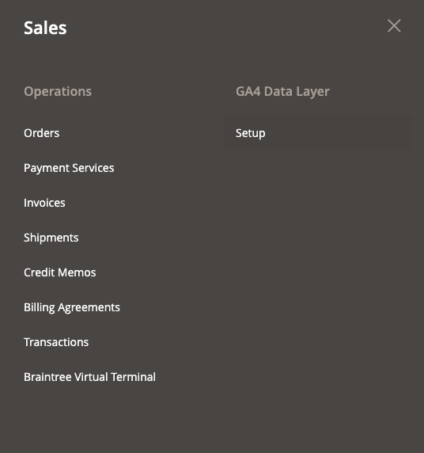

- **From the settings page:** **Stores › Configuration › Sales › GA4 Data Layer**, group *General*, button **Open setup wizard**. The wizard opens at the scope the settings page was showing.

**Permissions** (**System › Permissions › User Roles › Role Resources**):

- **Stores › Settings › Configuration › GA4 Data Layer** (`Hryvinskyi_DataLayerAdminUi::config`) opens the wizard and the settings page and allows saving.
- **Server-side delivery actions** (`Hryvinskyi_DataLayerServerSideAdminUi::delivery`), below it, is needed for **Send test event** and **Retry failed** in step 5. Without it the step shows the settings and the delivery status, and says why the tools are not offered.
- The purchase preview in step 4 shows a real order, so it also needs **Sales › Operations › Orders › Actions › View** (`Magento_Sales::actions_view`). Without it the purchase tab says it is not available.

### The page

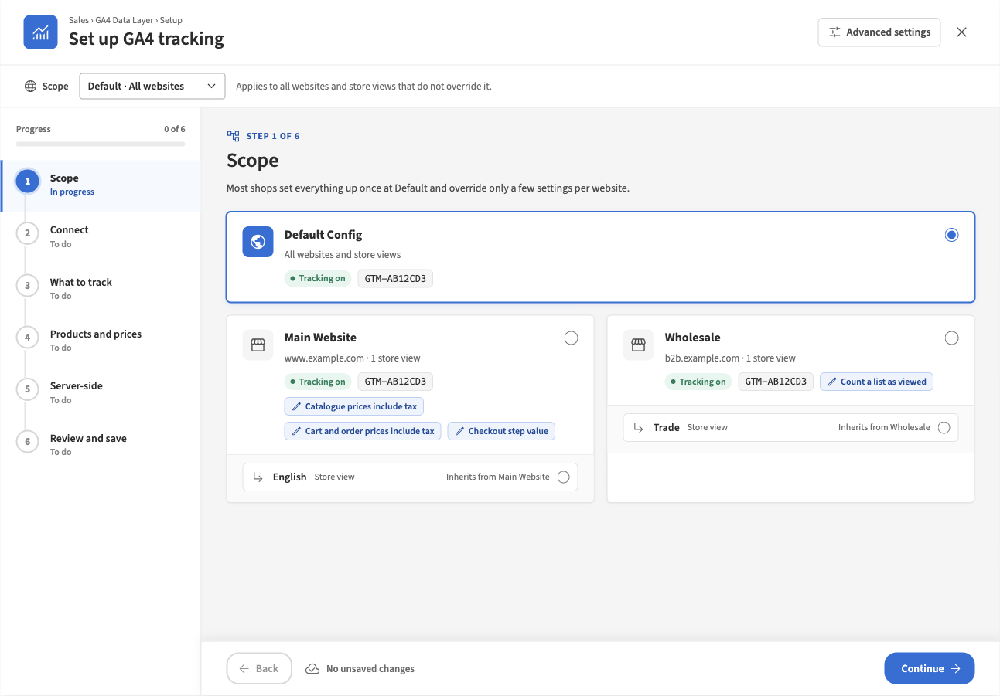

- **Header:** **Advanced settings** opens the settings page at the wizard's current scope; **×** (Close) leaves the wizard. If you have unsaved changes, both ask before leaving, and so does the browser when you close the tab.
- **Scope bar:** the scope you are editing, with a line saying who it applies to: *"Applies to all websites and store views that do not override it."*, *"Applies to the Wholesale website and its store views that do not override it."* or *"Applies to the English store view only. Nothing inherits from it."*. You can change scope at any time; your unsaved changes at every scope are kept.
- **Steps:** each step shows its state: *To do*, *In progress*, *Needs attention*, *Done* or *Skipped*, and once done a one-line summary (for example *Default · All websites*). *Progress* counts the completed steps. You can open any step directly.
- **Footer:** **Back**, the number of unsaved changes (*"3 unsaved changes · saved with Save all in the last step"*) and **Continue**. In the last step **Continue** becomes **Save all**.

**Continue does not save.** It checks the step and moves on. If a field has a problem, it stays on the step and moves the focus to that field.

### Scopes and inheritance

Settings follow Magento's scopes: **Default** (every website), **website** and **store view**. A store view uses its own value if it has one, else its website's, else Default's, else the built-in default. Under every field a line says where the value comes from:

| Line under the field | Meaning | Action offered |
| --- | --- | --- |
| *Built-in default · used by every website* | Nothing is stored; the module's default applies. | — |
| *Default · used by every website* | Set at Default, and no website or store view overrides it. | — |
| *Default · Main Website overrides* | Set at Default; the scopes named set their own value. | — |
| *Set for this website* / *Set for this store view* | This scope has its own value. | **Use inherited value** removes it, so the scope inherits again. |
| *Inherited from Main Website* / *Inherited from Default Config* / *Inherited from the built-in default* | This scope uses its parent's value. The field is read-only. | **Override here** gives the scope its own value, starting from the inherited one. |
| *Website setting — switch scope to Main Website* | The setting exists only at website level (for example every server-side setting), so it cannot be set for a store view. | — |
| A lock with a reason | The value is fixed in the deployment configuration (`app/etc/env.php`, `config.php` or an environment variable). The field shows the value the store uses and cannot be changed here. | — |

Each field also carries a badge with the narrowest scope it can be set at: **Store view**, **Website** or **Default**.

### Step 1: Scope

*"Most shops set everything up once at Default and override only a few settings per website."*

Pick the scope to configure from the cards. **Default Config** covers all websites and store views. Each website card shows its domain, the number of store views, whether tracking is on, the container in use, and an override badge for every setting the website sets itself (above: *Main Website* sends prices with tax and uses a different checkout step value; *Wholesale* counts lists when they scroll into view). Store views are listed under their website with *"Inherits from …"* when they set nothing themselves.

A shop with one website and one store view sees *"Your shop has one website, so Default is selected. You can skip this step."* with **Skip to Connect**.

### Step 2: Connect

*"Choose how your store loads Google's script."*

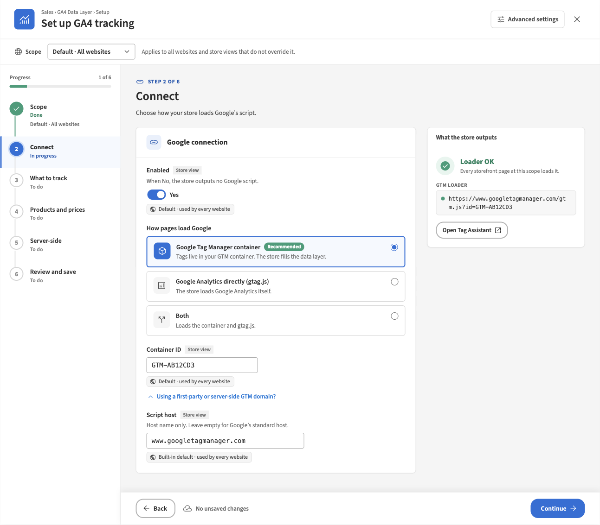

| Setting | What it does |
| --- | --- |
| **Enabled** | When No, the store outputs no Google script and sends no events. |
| **How pages load Google** | **Google Tag Manager container** (recommended): tags live in your GTM container and the store fills the data layer. **Google Analytics directly (gtag.js)**: the store loads Google Analytics itself. **Both**: loads the container and gtag.js. |
| **Container ID** | Your GTM container, `GTM-` followed by letters and digits. Shown for GTM and Both. |
| **Measurement ID** | Your GA4 web data stream, `G-` followed by letters and digits. Shown for gtag.js and Both. |
| **Script host** | Under *Using a first-party or server-side GTM domain?*. Host name only; leave empty for Google's standard host. |

The mode is not a setting of its own: it follows from which IDs are filled in. Choosing a mode clears the ID the mode does not use, at the current scope only. If one of the IDs is locked or cannot be changed at this scope, the modes are disabled with *"Choosing a mode changes …, which cannot be changed at this scope."*. Choosing **Both** shows the warning *"GA4 counts events twice if the container also has a GA4 tag for the same stream."*

**What the store outputs** shows the result at this scope: **Loader OK** (*Every storefront page at this scope loads it.*) with the script address and **Open Tag Assistant**; **Waiting for an ID**; **Invalid ID** (*Nothing is output until it's fixed.*); or **Sending is off**.

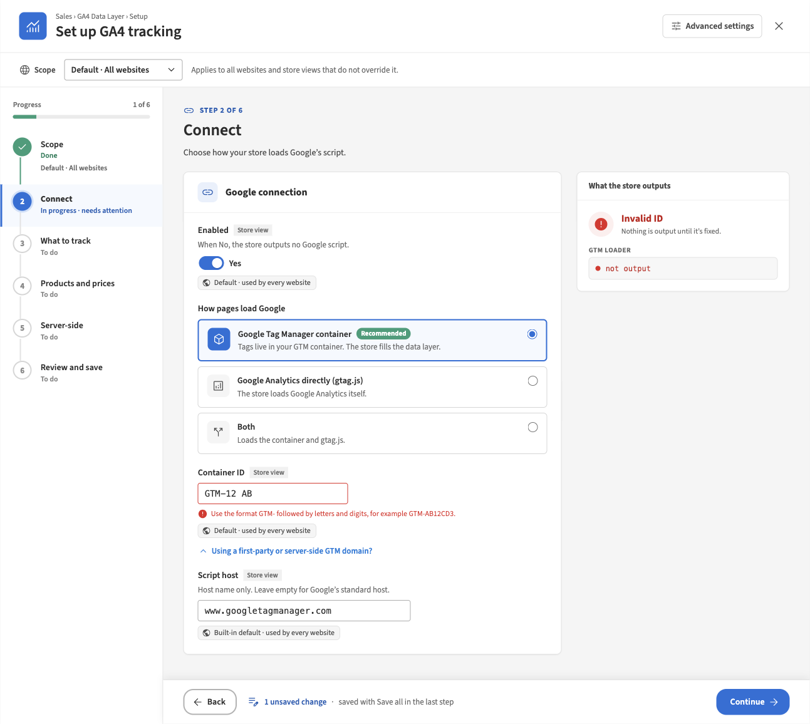

An ID with the wrong format is marked as you leave the field, and the step shows *Needs attention*. A container ID is required unless the mode is gtag.js; a measurement ID is required unless the mode is GTM.

### Step 3: What to track

*"Pick the closest preset, then fine-tune single events."*

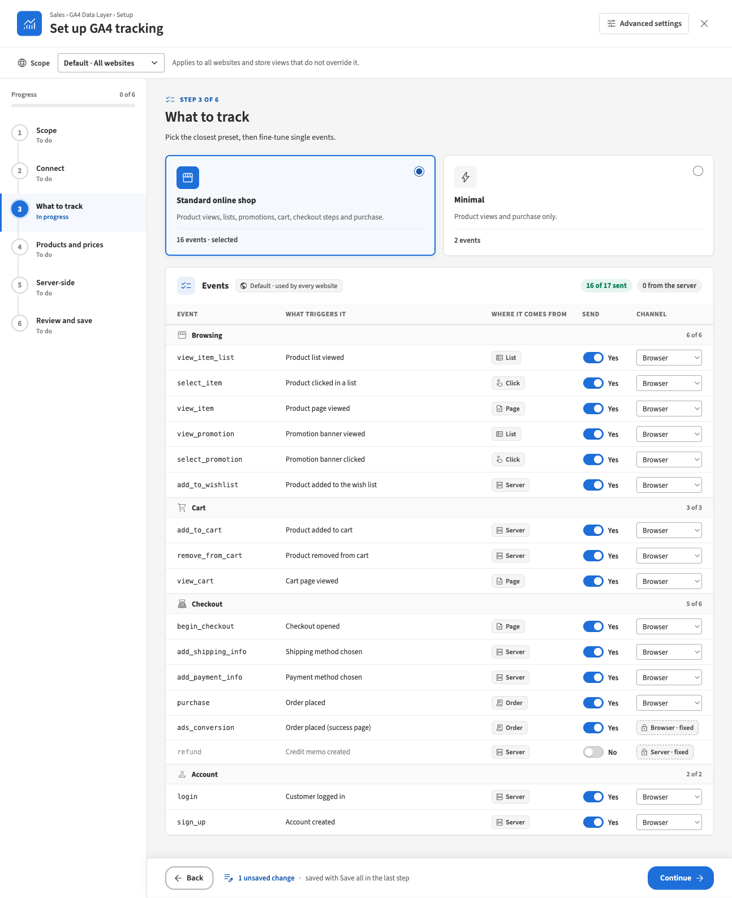

- **Presets.** Choosing a preset switches its events on and every other event off, and resets the channels of non-fixed events to Browser. Each card shows how many events it sends. When the table matches no preset, **Custom** is selected automatically (*"Selected automatically: the table differs from every preset."*).
- **The events table.** One row per known event, grouped (Browsing, Cart, Checkout, Account, and groups added by other modules), with what triggers it, where it comes from, a **Send** switch and a **Channel** choice. Fixed channels show as *Browser · fixed* or *Server · fixed*. The header counts *"16 of 17 sent"* and how many go *from the server*.
- The events table is one setting at each scope: when you override it at a website or store view, the whole selection and its channels are overridden together. Entries for events of modules that are no longer installed are kept when you save.

**Warnings** appear under the table and the step shows *Needs attention*:

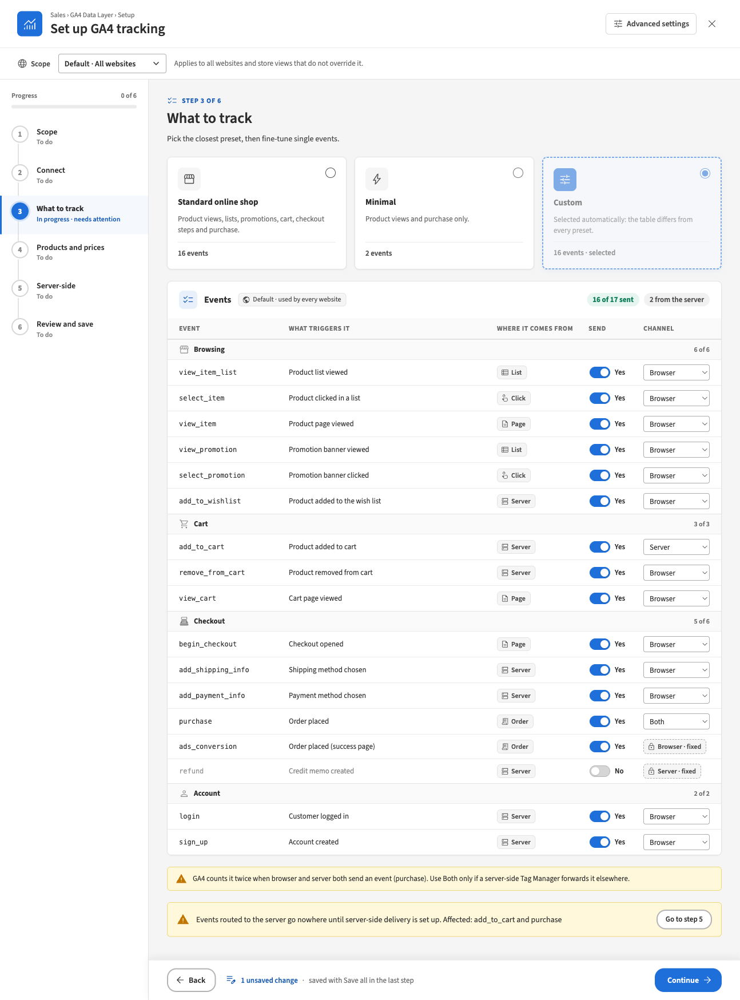

- *"GA4 counts it twice when browser and server both send an event (purchase). Use Both only if a server-side Tag Manager forwards it elsewhere."*
- *"Events routed to the server go nowhere until server-side delivery is set up. Affected: add_to_cart and purchase"*, with **Go to step 5** when the server-side step is installed.

At a scope that inherits the events, the reason is shown above the presets and the table is greyed out until you press **Override here**:

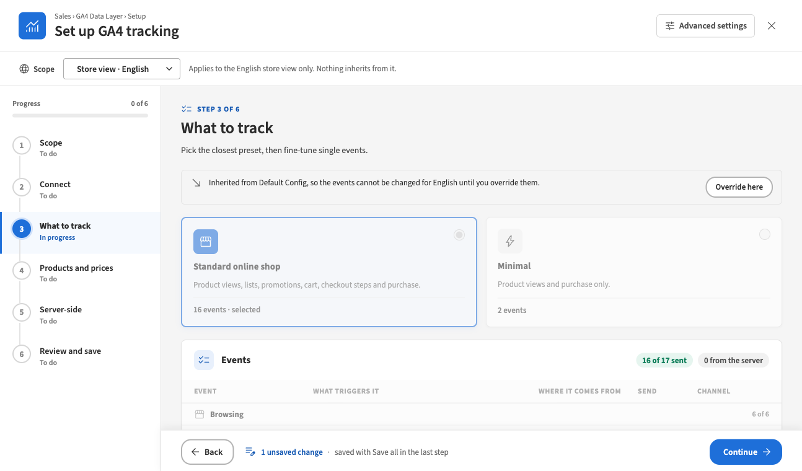

### Step 4: Products and prices

*"Choose which product data and prices GA4 receives."*

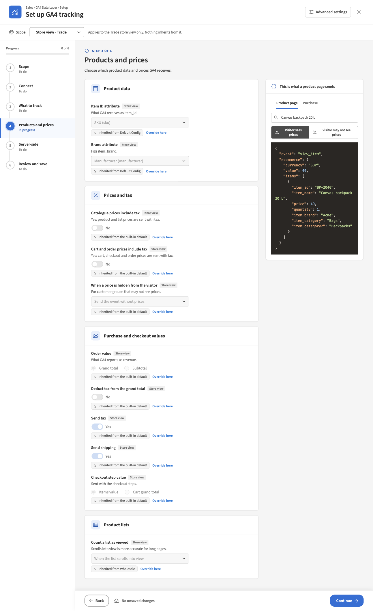

| Card | Setting | What it does |
| --- | --- | --- |
| Product data | **Item ID attribute** | What GA4 receives as `item_id`: Product ID, SKU or another text attribute. |
| | **Brand attribute** | Fills `item_brand` from a dropdown or multiselect attribute; *— Not sent —* by default. |
| Prices and tax | **Catalogue prices include tax** | Yes: product and list prices are sent with tax. |
| | **Cart and order prices include tax** | Yes: cart, checkout and order prices are sent with tax. |
| | **When a price is hidden from the visitor** | *Send the event without prices* or *Do not send ecommerce events*, for customer groups that may not see prices. |
| Purchase and checkout values | **Order value** | What GA4 reports as revenue: *Grand total* or *Subtotal*. |
| | **Deduct tax from the grand total** | Shown only for *Grand total*. Yes reports revenue excluding tax. |
| | **Send tax** / **Send shipping** | Fill `tax` and `shipping` in the purchase event. |
| | **Checkout step value** | Sent with the checkout steps: *Items value* or *Cart grand total*. |
| Product lists | **Count a list as viewed** | *When the page loads* or *When the list scrolls into view*; scrolling into view is more accurate for long pages. |

**The preview card** shows the exact event the store would build with the values on screen, including changes you have not saved. Nothing is saved and nothing is sent to Google.

- It previews a store view: the current scope if it is a store view, otherwise the first store view under it (*"Previewing English, the first store view under this scope."*). At Default with no store view there is nothing to preview.
- **Product page:** search a product by name or SKU (at least two characters; enabled products visible in that store view; up to ten results). The toggle **Visitor sees prices** / **Visitor may not see prices** shows what the store sends to someone who may not see the price, following *When a price is hidden from the visitor*:

  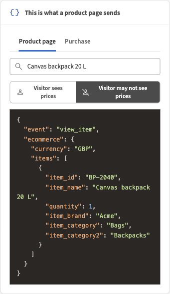

- **Purchase:** built from the **latest real order** of the store view (*"Built from the latest order of Trade."*). It needs permission to view orders. A store view without orders shows *"No orders in this store view yet."*

  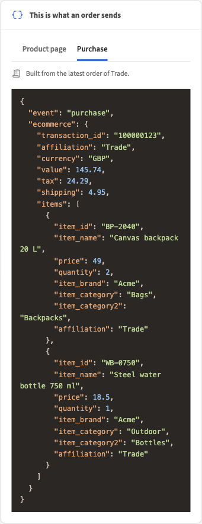

- When the event would not be sent (tracking off, the event switched off, prices hidden with *Do not send ecommerce events*, nothing reportable), the card says why instead of showing JSON.

### Step 5: Server-side

This step is present when the server-side modules are installed. *"Sends selected events, such as purchase, from Magento straight to Google, so ad blockers and closed tabs don't lose them. Optional: browser tracking keeps working without it."* It can be skipped with **Skip this step**. While delivery is off, only the **Enabled** switch is shown.

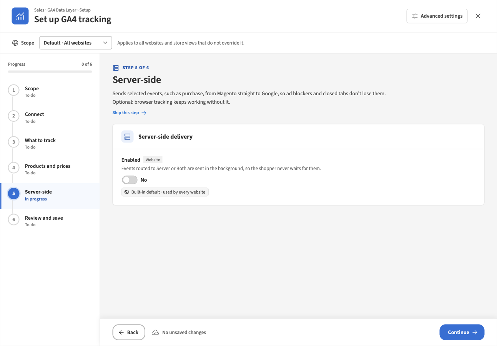

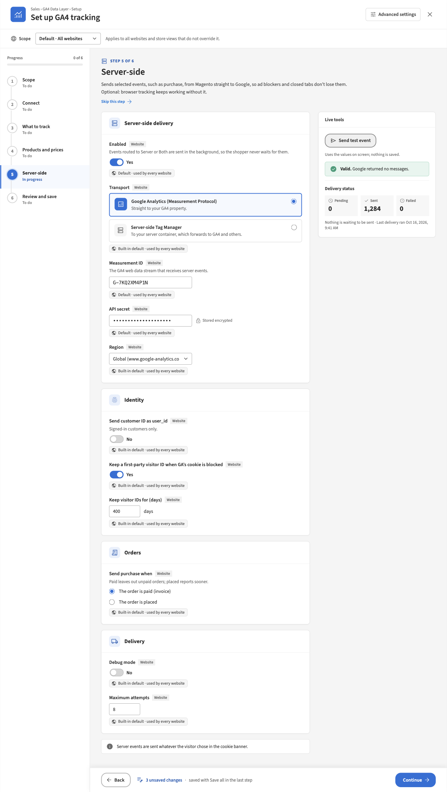

| Card | Setting | What it does |
| --- | --- | --- |
| Server-side delivery | **Enabled** | Events routed to Server or Both are sent in the background, so the shopper never waits for them. |
| | **Transport** | **Google Analytics (Measurement Protocol)**: straight to your GA4 property. **Server-side Tag Manager**: to your server container, which forwards to GA4 and others. |
| | **Measurement ID** | The GA4 web data stream that receives server events. Required for the Measurement Protocol. |
| | **API secret** | Measurement Protocol only. Required. Stored encrypted; the wizard shows only *Stored encrypted* and offers **Replace**. |
| | **Region** | Measurement Protocol only: *Global* or *EU only*. |
| | **Endpoint** / **API secret (optional)** | Server-side Tag Manager only: the container's https address with no path, and its own secret if it asks for one. |
| Identity | **Send customer ID as user_id** | Signed-in customers only. |
| | **Keep a first-party visitor ID when GA's cookie is blocked** | See section 7. |
| | **Keep visitor IDs for (days)** | 30 to 1000. |
| Orders | **Send purchase when** | *The order is paid (invoice)* or *The order is placed*. Paid leaves out unpaid orders; placed reports sooner. |
| Delivery | **Debug mode** | When on: *"Debug mode is on: events go to Google's validation endpoint and are NOT recorded in GA4."* |
| | **Maximum attempts** | How often a failed send is retried. |

The step ends with *"Server events are sent whatever the visitor chose in the cookie banner."*

**Live tools** (right):

- **Send test event** sends one test event with the values **on screen**, including unsaved ones (*"Uses the values on screen; nothing is saved."*). A stored API secret is used unless you typed a new one. The result is *Valid. Google returned no messages.*, a list of Google's validation messages, or the reason it could not be checked. Only the Measurement Protocol can be tested: a server container has no validation endpoint and would record the test.
- **Delivery status**: pending, sent and failed counts for the scope's website (all websites together at Default), with the oldest pending event and the last run. **Retry failed** appears while there are failed events.

**Server-side settings are per website.** At a store view they are shown read-only with *"Website setting — switch scope to Main Website"*; the tools work for that store view's website.

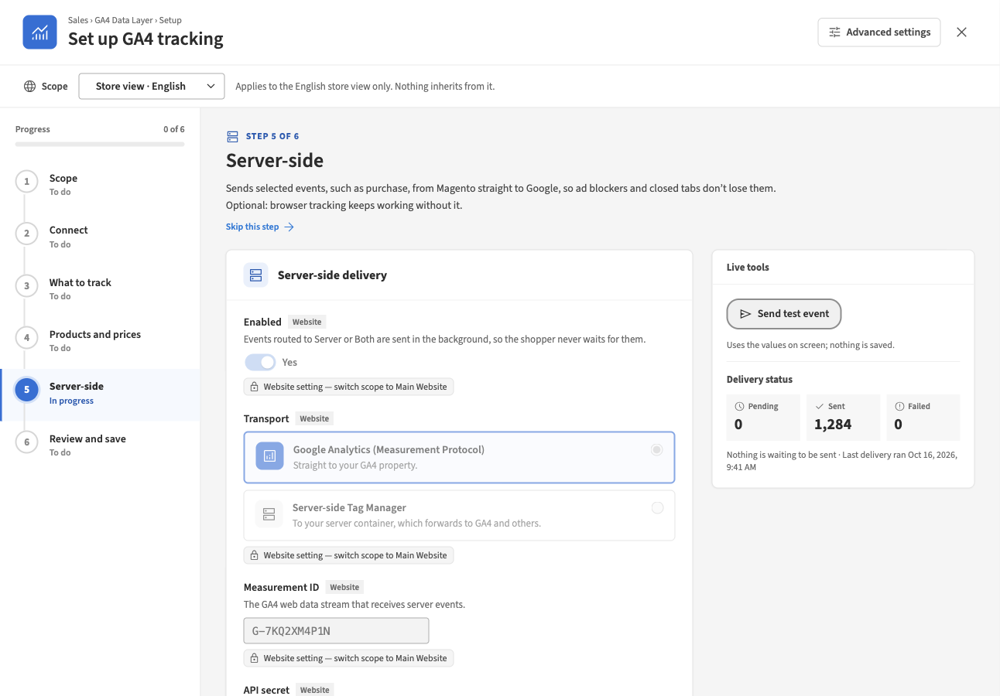

### Step 6: Review and save

*"Nothing reaches the store until you click Save all."*

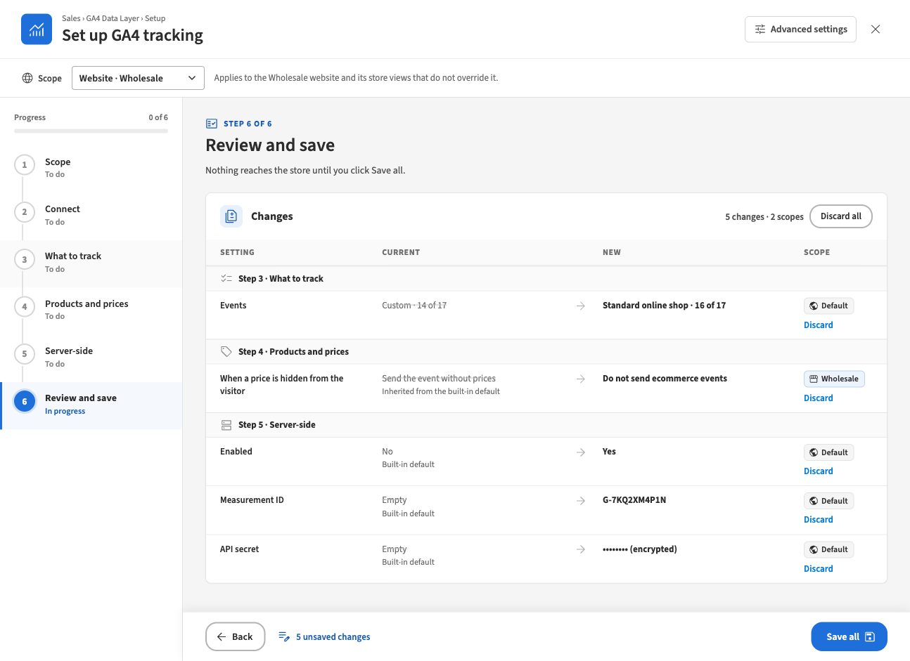

- The table lists every change against what is stored, grouped by step: the **setting**, its **current** value (with where it comes from), the **new** value and the **scope**. Secrets are never shown. The events setting is summarised as the preset name and the number of events sent.
- **Discard** removes one change; **Discard all** asks *"Discard every unsaved change?"*.
- **Save all is held back while a step has a problem** at a scope you changed: the step lists *"Fix these steps before saving:"* with each step and scope, and leads to it.
- **Save all** writes the changes as ordinary Magento configuration values, exactly as the settings page does: the same validation, the same events and the same cache handling. While it saves, the wizard cannot be edited, so what is saved is what you see.

When everything is saved, the step shows what was saved per scope and what to do next:

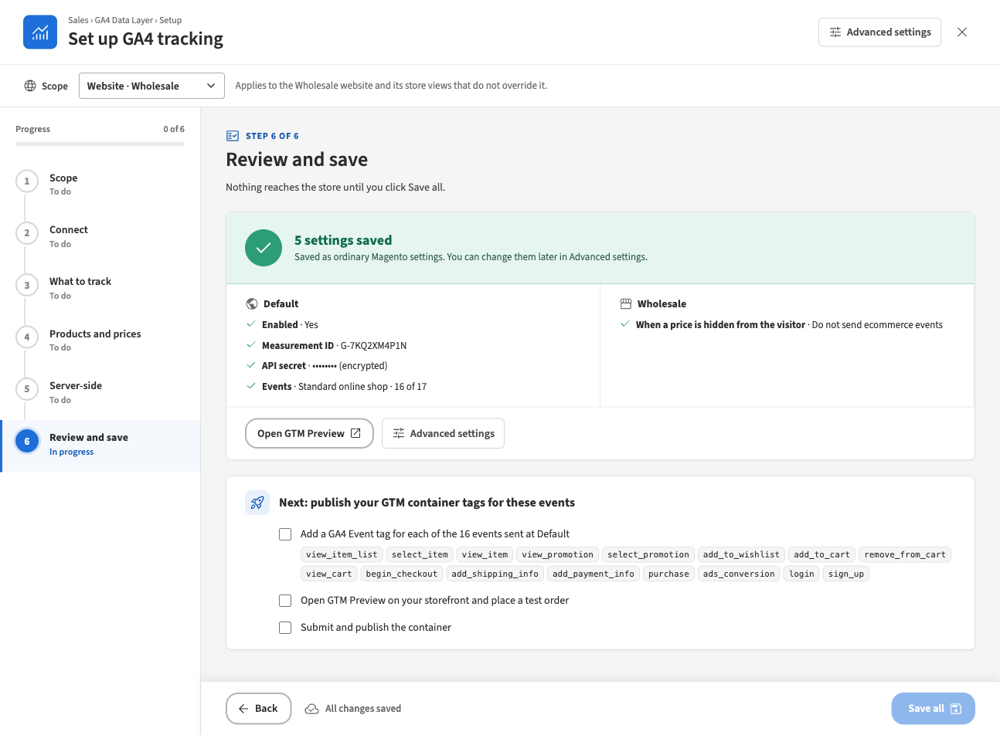

- *"Saved as ordinary Magento settings. You can change them later in Advanced settings."*
- **Next: publish your GTM container tags for these events**: a checklist with the events sent at each scope, *Open GTM Preview on your storefront and place a test order*, and *Submit and publish the container*. The ticks are a personal checklist and are not stored.

**When some changes fail.** Each change is reported on its own. If a change is refused (for example a value the store rejects, or a value locked in the deployment configuration), the step shows *"4 of 5 changes were saved. 1 could not be saved — see the marked rows."*; the saved changes are no longer pending and the failed ones stay, marked, for you to correct and save again. Sending the same changes again is harmless.

**When the request fails.** A red strip above the step explains it and every edit is kept:

| Message | What to do |
| --- | --- |
| *Your admin session has ended. Sign in again in another tab, then retry; your changes are kept.* | Sign in to the admin in another browser tab, come back and press **Retry**. |
| *Your role may not change these settings.* | Ask for the GA4 Data Layer permission. |
| *The store took too long to answer.* / *could not be reached.* / *could not complete the request.* | Try again. |

### Narrow windows

Below 1000 pixels of width the wizard switches to a single column: the steps become a row of chips under the scope bar and the side panels move under the settings.

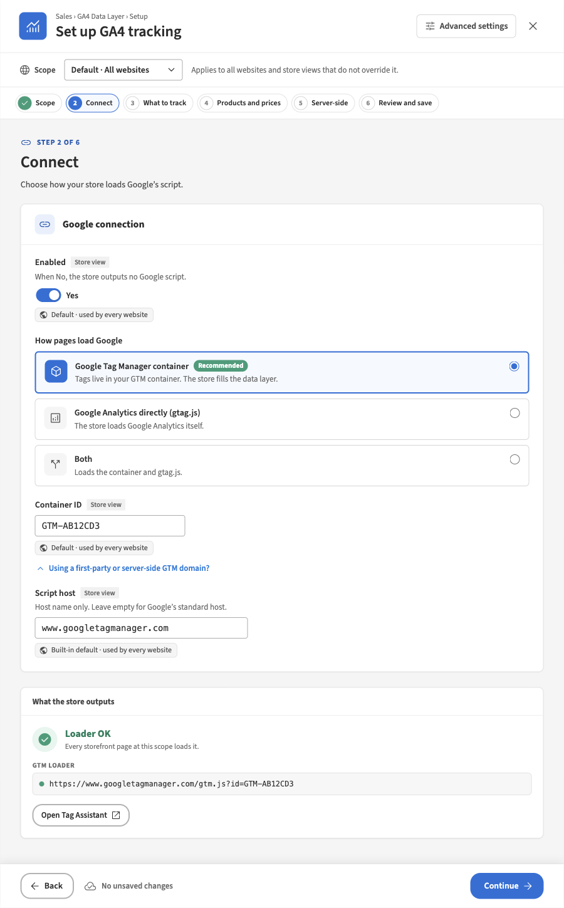

### The wizard and the settings page

The wizard and **Stores › Configuration › Sales › GA4 Data Layer** edit the same settings. The settings page remains the complete reference: it also has the Google Ads conversion settings, which the wizard does not show. A value saved in one appears in the other. Use **Advanced settings** in the wizard to jump to the settings page at the same scope.

---

## Settings reference

**Stores › Configuration › Sales › GA4 Data Layer.** All settings in the core groups can be set at **default, website and store view** scope; the Server-side group at **default and website** only. Paths are relative to `core_config_data` and can be used in `app/etc/config.php` or `env.php` to lock a value.

### General, Google Tag Manager, Google Analytics (gtag.js)

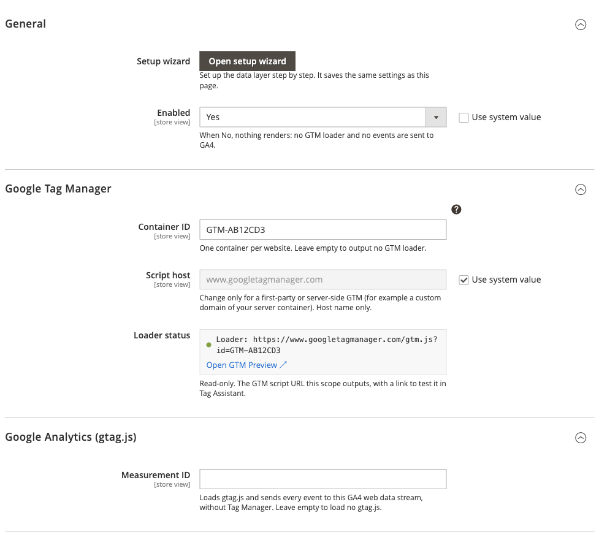

| Setting | Path | Default | Description |
| --- | --- | --- | --- |
| **Setup wizard** | — | — | Opens the setup wizard at the scope shown. Stores nothing. |
| **Enabled** | `hryvinskyi_datalayer/general/enabled` | No | When No, nothing renders: no GTM loader and no events are sent to GA4. |
| **Container ID** | `hryvinskyi_datalayer/gtm/container_id` | *(empty)* | `GTM-` followed by capital letters and digits. One container per website. Empty = no GTM loader. |
| **Script host** | `hryvinskyi_datalayer/gtm/script_host` | `www.googletagmanager.com` | Change only for a first-party or server-side GTM domain. Host name only, no `https://` or path. |
| **Loader status** | — | — | Read-only: the GTM script address this scope outputs, or why none, with **Open GTM Preview**. |
| **Measurement ID** | `hryvinskyi_datalayer/gtag/measurement_id` | *(empty)* | Loads gtag.js and sends every event to this GA4 web data stream. Upper-cased on save. Empty = no gtag.js. When the scope loads both a container and gtag.js, an amber warning about double counting appears. |

### Events

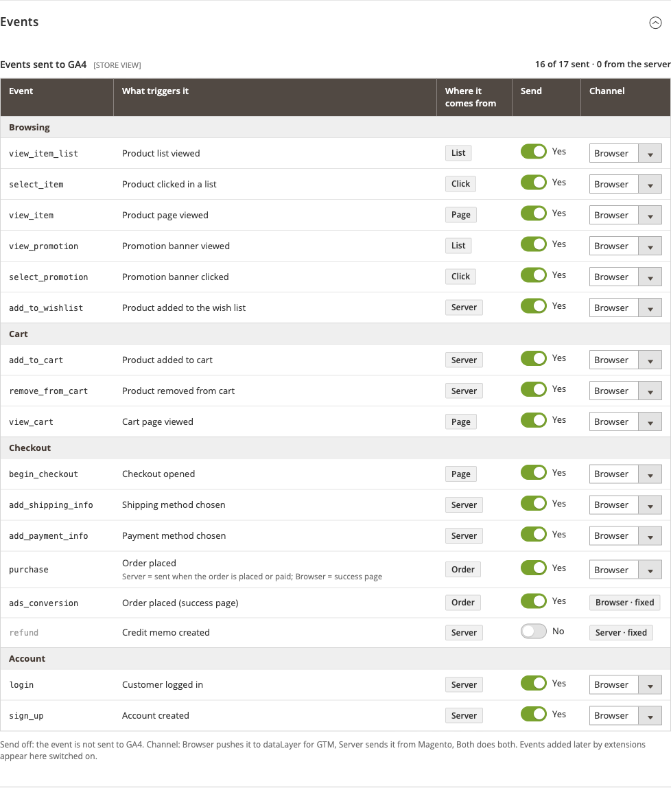

| Setting | Path | Default | Description |
| --- | --- | --- | --- |
| **Events sent to GA4** | `hryvinskyi_datalayer/events/disabled` | `refund` off | The events table: one row per known event with **Send** and **Channel**. Stored as the list of events switched off. |
| *(event routing)* | `hryvinskyi_datalayer/channels/routing` | All Browser | Saved by the same table: the events routed to Server or Both. |

One **Use Default** / **Use Website** checkbox covers both paths. The table warns when an event is routed to Both, and when server routes exist while server delivery is off for the website (with a link to the server-side settings).

### Items, Checkout steps, Purchase

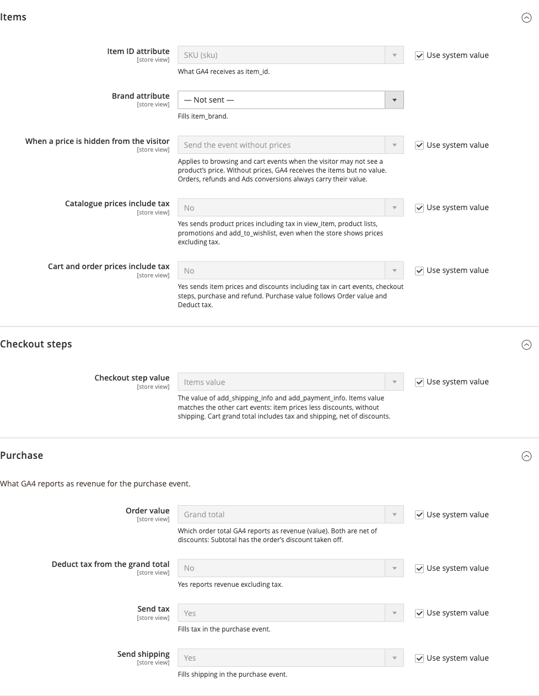

| Setting | Path | Default | Options |
| --- | --- | --- | --- |
| **Item ID attribute** | `hryvinskyi_datalayer/item/identifier_attribute` | `sku` | Product ID, or any text attribute |
| **Brand attribute** | `hryvinskyi_datalayer/item/brand_attribute` | *(not sent)* | Any dropdown or multiselect attribute |
| **When a price is hidden from the visitor** | `hryvinskyi_datalayer/item/hidden_price_handling` | `omit_price` | Send the event without prices · Do not send ecommerce events |
| **Catalogue prices include tax** | `hryvinskyi_datalayer/item/catalogue_price_includes_tax` | No | Yes / No |
| **Cart and order prices include tax** | `hryvinskyi_datalayer/item/line_price_includes_tax` | No | Yes / No |
| **Checkout step value** | `hryvinskyi_datalayer/checkout/step_value_basis` | `items` | Items value · Cart grand total |
| **Order value** | `hryvinskyi_datalayer/purchase/value_basis` | `grand_total` | Grand total · Subtotal (both net of discounts) |
| **Deduct tax from the grand total** | `hryvinskyi_datalayer/purchase/deduct_tax` | No | Shown for Grand total only |
| **Send tax** | `hryvinskyi_datalayer/purchase/include_tax` | Yes | Fills `tax` in purchase |
| **Send shipping** | `hryvinskyi_datalayer/purchase/include_shipping` | Yes | Fills `shipping` in purchase |

### Google Ads conversion, Product lists

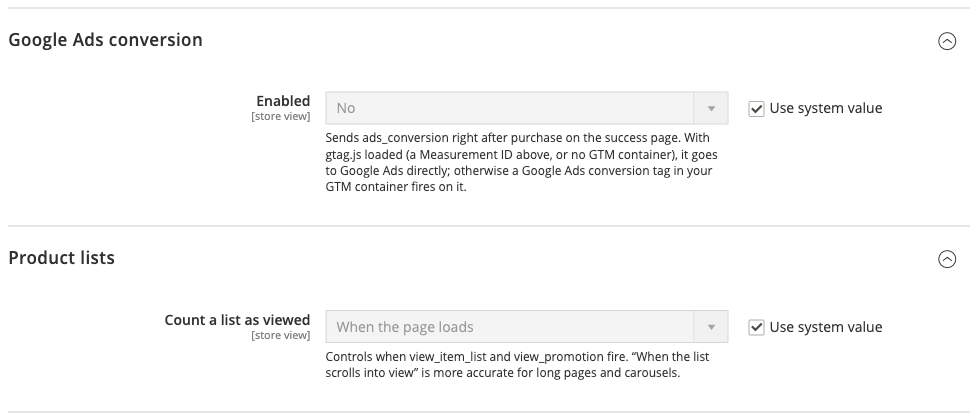

| Setting | Path | Default | Description |
| --- | --- | --- | --- |
| **Enabled** | `hryvinskyi_datalayer/ads/enabled` | No | Sends `ads_conversion` right after purchase on the success page (see section 3). |
| **Conversion ID** | `hryvinskyi_datalayer/ads/conversion_id` | *(empty)* | The Google Ads account, for example `AW-123456789`. |
| **Conversion label** | `hryvinskyi_datalayer/ads/conversion_label` | *(empty)* | The part after the slash in the conversion action's `send_to`. |
| **Conversion value** | `hryvinskyi_datalayer/ads/value_source` | `purchase` | Purchase value (same value and currency as `purchase`) · Fixed value |
| **Fixed value** | `hryvinskyi_datalayer/ads/fixed_value` | *(empty)* | Sent for every order, in the order's currency. Shown for Fixed value. |
| **Count a list as viewed** | `hryvinskyi_datalayer/lists/impression_trigger` | `load` | When the page loads · When the list scrolls into view. Applies to `view_item_list` and `view_promotion`. |

### Server-side

Added by the server-side modules. Default and website scope only.

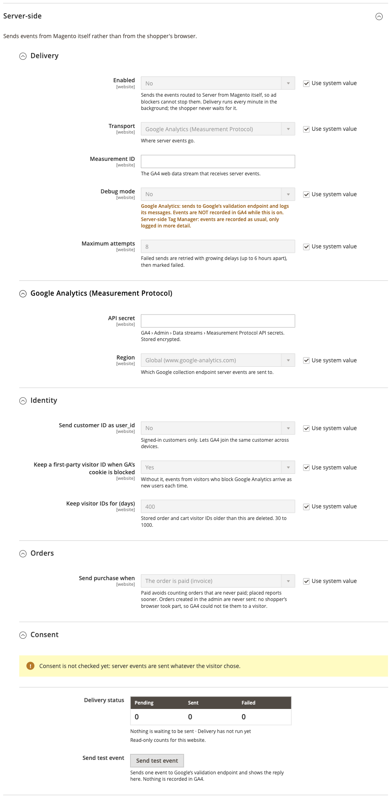

| Group | Setting | Path | Default | Description |
| --- | --- | --- | --- | --- |
| Delivery | **Enabled** | `hryvinskyi_datalayer_server/general/enabled` | No | Sends the events routed to Server from Magento. Delivery runs every minute in the background. |
| | **Transport** | `hryvinskyi_datalayer_server/general/transport` | `ga4` | Google Analytics (Measurement Protocol) · Server-side Tag Manager |
| | **Measurement ID** | `hryvinskyi_datalayer_server/ga4/measurement_id` | *(empty)* | The GA4 web data stream that receives server events. |
| | **Debug mode** | `hryvinskyi_datalayer_server/delivery/debug` | No | Measurement Protocol: validation only, events are **not recorded** in GA4. Server-side Tag Manager: recorded as usual, logged in more detail. |
| | **Maximum attempts** | `hryvinskyi_datalayer_server/delivery/max_attempts` | 8 | 1 to 20. Retries with growing delays, up to 6 hours apart, then marked failed. |
| Google Analytics (Measurement Protocol) | **API secret** | `hryvinskyi_datalayer_server/ga4/api_secret` | *(empty)* | From GA4 › Admin › Data streams › Measurement Protocol API secrets. Encrypted; never written by `app:config:dump`. |
| | **Region** | `hryvinskyi_datalayer_server/ga4/region` | `global` | Global (www.google-analytics.com) · EU only (region1.google-analytics.com) |
| Server-side Tag Manager | **Endpoint** | `hryvinskyi_datalayer_server/sgtm/endpoint` | *(empty)* | `https://host[:port]`, no path or query, a public address. |
| | **API secret (optional)** | `hryvinskyi_datalayer_server/sgtm/api_secret` | *(empty)* | Only when your server container asks for one. Never the GA4 secret. |
| Identity | **Send customer ID as user_id** | `hryvinskyi_datalayer_server/identity/send_user_id` | No | Signed-in customers only. |
| | **Keep a first-party visitor ID when GA's cookie is blocked** | `hryvinskyi_datalayer_server/identity/fallback_cookie` | Yes | Without it, visitors who block Google Analytics arrive as new users each time. |
| | **Keep visitor IDs for (days)** | `hryvinskyi_datalayer_server/identity/retention_days` | 400 | 30 to 1000. |
| Orders | **Send purchase when** | `hryvinskyi_datalayer_server/orders/purchase_trigger` | `paid` | The order is paid (invoice) · The order is placed |
| Consent | *(notice)* | — | — | Consent is not checked yet: server events are sent whatever the visitor chose. |
| | **Delivery status** | — | — | Read-only counts for the website (all websites at default), oldest pending event, last run, latest failure and **Retry failed**. |
| | **Send test event** | — | — | Sends one event to Google's validation endpoint and shows the reply. Nothing is recorded. |

---

## Server-side delivery

Server delivery sends events from Magento to Google instead of, or as well as, from the shopper's browser. Ad blockers cannot stop it, and an order is reported even when the shopper closes the tab before the success page.

### Transports

| Transport | Where events go | What it needs |
| --- | --- | --- |
| **Google Analytics (Measurement Protocol)** | `https://www.google-analytics.com/mp/collect` (or the EU endpoint) | Measurement ID and API secret. |
| **Server-side Tag Manager** | `<endpoint>/mp/collect` on your server container, which forwards to GA4 and other platforms | Endpoint; the measurement ID is passed on; an optional container secret. |

Secrets are never sent in the request body and are removed from every log line and error message. For security, the endpoint must be a public https address: local and private network addresses are refused.

### How delivery works

1. An event routed to **Server** or **Both** is written to an outbox (table `hryvinskyi_datalayer_server_event`) instead of being sent during the shopper's request. Events from the browser routed to the server reach the store's collector by `sendBeacon` and are stored the same way.
2. A cron job in its own group (`hryvinskyi_datalayer`) runs every minute, sends pending events in batches (up to 25 events per request for the same visitor) and records the outcome.
3. A failed send is retried with growing delays, at most 6 hours apart, until *Maximum attempts* is reached; then the event is marked failed. Events older than 72 hours are not sent (a Measurement Protocol limit).
4. An event is stored only once: a second `purchase` for the same order or `refund` for the same credit memo is ignored.

Sent events are kept 7 days and failed events 30 days; visitor IDs for *Keep visitor IDs for (days)*.

### Status, retry and test

- **Delivery status** (settings page and wizard step 5): pending, sent and failed counts, the oldest pending event, the last run and the latest error.
- **Retry failed** puts failed events of the last 72 hours back in the queue with fresh attempts.
- **Send test event** sends one fixed test event through the Measurement Protocol's validation endpoint and shows Google's reply. Nothing is recorded in GA4 and nothing goes through the outbox.
- Command line: `bin/magento hryvinskyi:datalayer:server:status` and `bin/magento hryvinskyi:datalayer:server:retry-failed [--website=<id>]`.

### Identity

- The GA4 client ID and session are read from the visitor's `_ga` cookies.
- **First-party visitor ID.** When Google Analytics' cookie is blocked, the store can keep its own visitor ID in a first-party cookie (`hdl_cid`, two years), set when the cart is saved. Without it those visitors arrive in GA4 as new users each time, and their events cannot be stored, because the Measurement Protocol requires a client ID.
- **user_id** is the customer ID of a signed-in customer when *Send customer ID as user_id* is on.
- The visitor is recorded with the cart and copied to the order, so order events sent later (when the order is paid, or as a refund) are tied to the shopper who placed it.

### Purchase: paid or placed

- **The order is paid (invoice)** (default) avoids counting orders that are never paid. Payment methods that are invoiced late are reported late, and orders that are never invoiced are not reported.
- **The order is placed** reports sooner, but also counts orders whose payment is later abandoned.
- **Orders created in the admin are never sent**: no shopper's browser took part, so GA4 could not tie them to a visitor. A storefront order invoiced in the admin is sent.

### Consent

Consent is not checked by server delivery today: server events are sent whatever the visitor chose in the cookie banner. In the browser, consent is handled by Google Tag Manager (Consent Mode); the module always pushes to `dataLayer`, and your tags decide what to send. Take this into account before routing events to the server.

### Debug mode

With the Measurement Protocol, debug mode sends to Google's validation endpoint and logs its messages: **events are not recorded in GA4**. Switch it off after testing. With a server-side Tag Manager, events are recorded as usual and only logged in more detail.

---

## Permissions

**System › Permissions › User Roles › Role Resources**:

| Resource | Grants |
| --- | --- |
| **Stores › Settings › Configuration › GA4 Data Layer** (`Hryvinskyi_DataLayerAdminUi::config`) | The whole settings section (including Server-side), the menu **Sales › GA4 Data Layer › Setup** and every wizard action. |
| **… › Server-side delivery actions** (`Hryvinskyi_DataLayerServerSideAdminUi::delivery`) | **Retry failed** and **Send test event**, on the settings page and in the wizard. |
| **Sales › Operations › Orders › Actions › View** (`Magento_Sales::actions_view`) | Needed in addition for the purchase preview in the wizard, because it shows a real order. |

A setting that a module places in another configuration section is shown and saved in the wizard only for users allowed to open that section.

---

## Going-live checklist

1. **Disable or remove Magento's own Google modules** if they are still installed, and check that the migrated Measurement ID and Google Ads settings are what you expect.
2. **Decide how pages load Google** per website: a GTM container (recommended) or gtag.js. Avoid loading both for the same GA4 stream.
3. **Choose the events** (a preset, then single events) and keep every event on the Browser channel unless server delivery is set up.
4. **Set item and price options**: item ID attribute, brand attribute, tax bases, order value, and the behaviour for hidden prices if some customers cannot see prices. Check the result in the wizard's preview.
5. **In your GTM container:**
   - add a GA4 Configuration (Google tag) for your measurement ID;
   - add a **GA4 Event** tag for each event the store sends, triggered by a Custom Event trigger with the event's name, with *Send Ecommerce data* from the data layer;
   - add a **Google Ads Conversion Tracking** tag on `ads_conversion` if you use Ads conversions in GTM mode.
6. **Test with GTM Preview** (Tag Assistant): browse a category, open a product, add to cart, go through checkout and **place a test order**. Check each event and its `ecommerce` object.
7. **Submit and publish** the container.
8. **Server delivery (optional):** create a Measurement Protocol API secret, enter it with the measurement ID per website, press **Send test event**, then route the chosen events (typically `purchase`) to Server. Check the delivery status after the first orders. Make sure debug mode is off.
9. **Switch tracking on** (*General › Enabled*) and **refresh Full Page Cache**.
10. **Grant permissions**: the GA4 Data Layer resource to whoever maintains tracking, and *Server-side delivery actions* only to those who should send test events or retry deliveries.

---

## Troubleshooting and FAQ

**Nothing appears in `dataLayer` or in GA4.**
- *Enabled* is No at that store view (the wizard's scope cards show *Tracking off*).
- Neither a container ID nor a measurement ID is set: events are pushed, but no Google script loads.
- The container ID is lower-case or has spaces: it must be `GTM-` followed by capital letters and digits.
- The theme does not render Head Tag Manager's head output, so nothing reaches `<head>`.
- Full Page Cache was not refreshed after installing or changing settings.
- The event is switched off in the events table.

**Every event is counted twice.**
- The scope loads gtag.js with a measurement ID **and** a container with a GA4 tag for the same stream (the settings page and the wizard warn about this). Keep one.
- An event is routed to **Both** while both copies reach GA4.
- The container fires its own GA4 `purchase` from the browser while `purchase` is also routed to Server.

**Cart events are missing.**
- On a headless (GraphQL) storefront, use the Server channel.
- A checkout page built without Magento's standard page layout does not load the scripts; the queued events are pushed on the next page that does.
- Requests from another domain than the store's base URL are refused by the queue endpoints.

**`purchase` is missing on the success page.** It is routed to Server, which sends it from Magento instead; check the delivery status. With the Browser channel, it is sent once per order per session, so reloading the success page does not send it again.

**Server events do not arrive.**
- The `hryvinskyi_datalayer` cron group is not running: check `bin/magento hryvinskyi:datalayer:server:status` for the last run and the oldest pending event.
- Wrong measurement ID or API secret: use **Send test event**.
- Debug mode is on: events are validated but not recorded.
- The order was created in the admin (never sent), or the trigger is *paid* and the order was never invoiced.
- The visitor had no Google Analytics cookie and the first-party visitor ID is switched off.
- After correcting the settings, use **Retry failed** (events of the last 72 hours).

**Events routed to Server go nowhere.** Server delivery is off for that website. Switch it on (wizard step 5) or route the events back to Browser.

**Prices are missing from events.** A module has declared that the visitor may not see the price, and *When a price is hidden from the visitor* is *Send the event without prices*. Orders always carry their value.

**The wizard says my session has ended.** Your admin session expired while the wizard was open. Sign in again in another tab and press **Retry**; your changes are kept.

**Save all is greyed out or refuses to save.** Either there is nothing to save, or a step has a problem at a scope you changed: the review step lists which steps to fix.

**I changed something in the wizard but the storefront did not change.** Nothing is stored until **Save all**. After saving, refresh Full Page Cache.

**Can I use the settings page and the wizard together?** Yes. They read and write the same settings. Saving in one is visible in the other on its next load.

**Known limitations.**
- An `http://` product link on an `https://` page counts as another origin, so it sends no `select_item`.
- Search widgets that render results outside Magento's product list blocks are not tracked as lists.
- The store's Content Security Policy covers Google's tag, analytics and ads hosts. Other tags loaded by your container need their own policy entries.
- Measurement Protocol events are not bot-filtered by Google; only known crawlers are refused by the collector.

---

## For developers

### How it works (in brief)

- **One pipeline for every event.** Event builders create events from the page, the cart or the order; the item builder fills items through field providers; event modifiers can change or drop an event; the dispatcher routes it to the browser queue, the page or the server outbox according to the event's channel.
- **Settings drafts for previews.** The wizard's preview and test event run the real builders under a request-scoped overlay of the unsaved values, which is always cleared afterwards. Nothing is written to show what saving would do.
- **The wizard writes through Magento's configuration model**, one save per scope, so backend models, the section-changed event and cache cleaning run exactly as on the settings page.
- **Browser code** is plain ES modules loaded through an import map; the wizard is a Preact application built from TypeScript sources shipped with the module.

### Extension points

Except where a row says otherwise, each is registered in `di.xml` as an item of the named argument.

| To… | Implement / register |
| --- | --- |
| Change, replace or drop an event | `Hryvinskyi\DataLayerApi\Api\EventModifierInterface` in `modifiers` of `Hryvinskyi\DataLayer\Model\EventModifierPipeline` |
| Add item fields | `Hryvinskyi\DataLayerApi\Api\ItemFieldProviderInterface` in `providers` of `Hryvinskyi\DataLayer\Model\ItemBuilder` (sort order; core providers use 10–80) |
| Hide prices from some visitors | `Hryvinskyi\DataLayerApi\Api\PriceVisibilityInterface` in `contributions` of `Hryvinskyi\DataLayer\Model\PriceVisibility` |
| Stop tracking some carts | `Hryvinskyi\DataLayerApi\Api\CartTrackingPolicyInterface` in `rules` of `Hryvinskyi\DataLayer\Model\CartTrackingPolicy` |
| Give a special cart its own event names | `Hryvinskyi\DataLayerApi\Api\CartKindInterface` in `kinds` of `Hryvinskyi\DataLayer\Model\Cart\CartEventNaming` |
| Register a new event | An item in `events` of `Hryvinskyi\DataLayer\Model\KnownEvents` (`label`, `group`, `groupCode`, `trigger`, `source`, `sourceCode`, `browserOriginated`); it then appears in the events table, the wizard and the routing |
| Fix an event's channel | `channels` of `Hryvinskyi\DataLayer\Model\FixedChannels` |
| Add or extend a preset | `presets` of `Hryvinskyi\DataLayer\Model\EventPresets` (`label`, `description`, `sortOrder`, `icon`, `extends`, `events`) |
| Add page events | `Hryvinskyi\DataLayer\Api\PageEventSourceInterface` in the `page_event_sources` argument of the `hryvinskyi.datalayer.bootstrap` block |
| Track another product list block | `Hryvinskyi\DataLayerFrontendUi\Api\Lists\ListContextInterface` in `listContexts`, keyed by block name |
| Send a list or promotions from your own block | Call `Hryvinskyi\DataLayerApi\Api\ListDataRendererInterface::renderProductList()` (an `item_list_id`, an `item_list_name` and the products in display order) or `renderPromotions()` (a list of `Hryvinskyi\DataLayerApi\Api\Data\PromotionInterface`, created through its generated factory), and append the result to the block's HTML. In an after-plugin on a cached block, append it through `Hryvinskyi\DataLayerApi\Api\BlockListDataInterface::append()` so it survives the block cache. The storefront then sends `view_item_list` / `select_item` or `view_promotion` / `select_promotion` as for core lists. |
| Add browser settings | `Hryvinskyi\DataLayerApi\Api\BrowserConfigProviderInterface` in `providers` of `Hryvinskyi\DataLayerFrontendUi\Model\Browser\BrowserConfig` |
| Hook every push in the browser | An ES module exporting `default function (api)` (`api.config`, `api.push`, `api.beforePush`, `api.onPush`), listed in `plugins` of `Hryvinskyi\DataLayerFrontendUi\Model\Browser\PluginUrls` |
| Receive server-channel events | `Hryvinskyi\DataLayerApi\Api\ServerEventSinkInterface` in `sinks` of `Hryvinskyi\DataLayer\Model\EventDispatcher` |
| Add a server transport | `Hryvinskyi\DataLayerServerSide\Api\TransportInterface` in `transports` of `Hryvinskyi\DataLayerServerSide\Model\Transport\TransportPool`, plus its label in the admin's `Transports` source |

### Adding settings or a step to the wizard

A module joins the wizard without the wizard naming it:

1. **Settings.** Add items to `descriptors` of `Hryvinskyi\DataLayerAdminUi\Model\Setup\SettingDescriptors`: a key with `path`, `kind` (`flag`, `choice`, `text`, `number` or `secret`), `step`, and optionally `pattern` (the PHP constant your backend model validates with), `caseInsensitive`, `min` and `max`. Labels, options and scope come from the field in `system.xml`.
2. **Wording, data and browser code.** Add a `Hryvinskyi\DataLayerAdminUi\Api\Setup\SetupContributionInterface` to `contributions` of `Hryvinskyi\DataLayerAdminUi\Model\Setup\SetupContributions`. It returns its phrases (translated when read), its plugin (an id and a browser module specifier), the import that maps the specifier to `Vendor_Module::js/…`, and any page data the step needs.
3. **A step.** The plugin module's default export receives the wizard's SDK:

   ```js
   export default function register(sdk) {
       sdk.registerStep({ id: 'my_step', after: 'products', icon: 'tune',
           title: 'my.step.title', intro: 'my.step.intro', skippable: true,
           component: MyStep, summary: mySummary });
       sdk.registerRequirement(/* a required-field rule */);
       const data = sdk.extensionData('my_plugin');
   }
   ```

   A plugin that fails to register is logged and left out; the rest of the wizard keeps working. A setting that cannot be saved the generic way can provide its own `Hryvinskyi\DataLayerAdminUi\Api\Setup\SettingFieldsInterface` in `fields` of `Hryvinskyi\DataLayerAdminUi\Model\Setup\SettingFieldsPool`.

---

*Modules: `Hryvinskyi_DataLayerApi`, `Hryvinskyi_DataLayer`, `Hryvinskyi_DataLayerFrontendUi`, `Hryvinskyi_DataLayerAdminUi`, `Hryvinskyi_DataLayerServerSide`, `Hryvinskyi_DataLayerServerSideFrontendUi`, `Hryvinskyi_DataLayerServerSideAdminUi`.*
