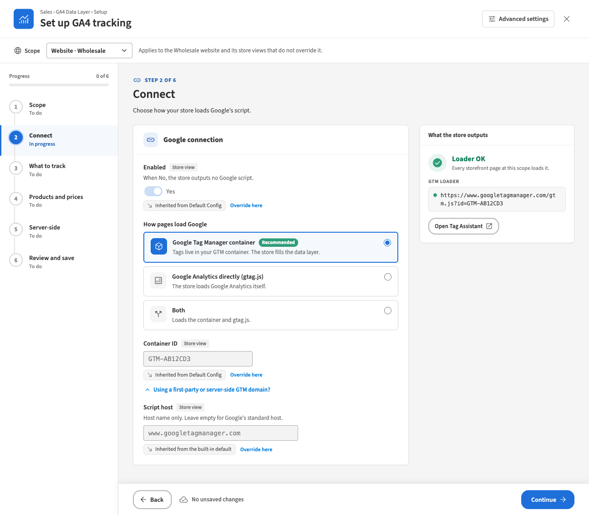

This manual is for store administrators and marketing staff who set up and look after GA4 tracking in the Magento admin. Each section is one task with numbered steps. For the full description of every setting and event, see the *GA4 Data Layer User Guide*.

The screenshots come from a test shop with two websites: *Main Website* (www.example.com, store view *English*) and *Wholesale* (b2b.example.com, store view *Trade*). The examples use the container ID `GTM-AB12CD3` and the measurement ID `G-7KQ2XM4P1N`. Use your own IDs.

**Before you start, you need:**

- **An admin account with the GA4 Data Layer permission.** Your administrator grants it under **System › Permissions › User Roles › Role Resources**, as **Stores › Settings › Configuration › GA4 Data Layer**. Two more permissions unlock extra tools:
  - **Server-side delivery actions** (below the GA4 Data Layer entry) for **Send test event** and **Retry failed**.
  - **Sales › Operations › Orders › Actions › View** for the purchase preview in the wizard, because it shows a real order.
- **Your Google Tag Manager container ID**, `GTM-` followed by capital letters and digits, for example `GTM-AB12CD3`. You find it at the top of your container in Google Tag Manager.
- **Your GA4 measurement ID**, `G-` followed by letters and digits, for example `G-7KQ2XM4P1N`. You find it in GA4 under **Admin › Data streams**, on your web stream.
- **For server-side delivery only: a Measurement Protocol API secret.** Create it in GA4 under **Admin › Data streams ›** your web stream **› Measurement Protocol API secrets**. Copy the secret value; you enter it once in Magento.

> **Tracking is off after installation.** The setting **Enabled** starts at **No**, so the store sends nothing to Google until you switch it on (task 2).

---

## Open the GA4 Data Layer

You need this every time you work on GA4 tracking. There are two screens: the **setup wizard**, which guides you step by step, and the **settings page** (*Advanced settings*), which lists every setting. Both change the same settings.

1. In the admin menu, click **Sales**.
2. Under **GA4 Data Layer**, click one of:
   - **Setup** to open the setup wizard (*Set up GA4 tracking*).
   - **Advanced settings** to open the settings page (**Stores › Configuration › Sales › GA4 Data Layer**).

   

3. To move between the two screens:
   - In the wizard, click **Advanced settings** at the top right. The settings page opens at the scope the wizard was showing.
   - On the settings page, in the **General** group, click **Open setup wizard**. The wizard opens at the scope the settings page was showing.
4. To leave the wizard, click **×** (Close) at the top right. If you have unsaved changes, the wizard asks before it closes.

**Result:** you see either *Set up GA4 tracking* (the wizard) or the *Configuration* page with the GA4 Data Layer groups.

> The settings page also has the **Google Ads conversion** settings, which the wizard does not show.

---

## Set up tracking for the first time with the wizard

You need this when the modules are newly installed, or when you want to walk through every choice again. The wizard has six steps. **Nothing is saved until you click Save all in step 6.** **Continue** only checks the step and moves on.

### How the wizard page works

- **Scope bar** (top): the scope you are editing, for example **Default · All websites**, and a line saying who the settings apply to.
- **Step list** (left): each step shows *To do*, *In progress*, *Needs attention*, *Done* or *Skipped*. Click a step to open it directly. **Progress** counts the finished steps.
- **Footer** (bottom): **Back**, the number of unsaved changes (for example *3 unsaved changes · saved with Save all in the last step*) and **Continue**. In step 6, **Continue** becomes **Save all**.
- Under each field, a line says where the value comes from, for example *Default · used by every website* or *Inherited from Default Config*. Task 6 explains these lines.

### Step 1: Scope

1. Open the wizard (**Sales › GA4 Data Layer › Setup**).
2. Click the **Default Config** card. Most shops set everything up once at Default and change only a few settings per website later (task 6).
3. Click **Continue**.

If your shop has one website, the step says *"Your shop has one website, so Default is selected. You can skip this step."* Click **Skip to Connect**.

### Step 2: Connect

This step decides how your store pages load Google's script.

1. Set **Enabled** to **Yes**. When it is **No**, the store outputs no Google script and sends no events.
2. Under **How pages load Google**, choose **Google Tag Manager container** (marked *Recommended*). Your tags then live in your GTM container and the store fills the data layer.
   - Choose **Google Analytics directly (gtag.js)** only if you do not use Tag Manager.
   - Avoid **Both** unless your developer or agency asks for it. If the container also has a GA4 tag for the same stream, GA4 counts every event twice, and the wizard warns you about this.
3. In **Container ID**, enter your container ID, for example `GTM-AB12CD3`.
4. Leave **Using a first-party or server-side GTM domain?** closed unless your agency gave you a script host.
5. Check the **What the store outputs** panel on the right. It should show **Loader OK** with the script address.
6. Click **Continue**.

**Check:** if the panel shows **Invalid ID**, the field is marked red and the step shows *Needs attention*. Correct the ID: it must be `GTM-` followed by capital letters and digits, with no spaces.

### Step 3: What to track

This step decides which events the store sends and where each one goes.

1. Click the **Standard online shop** preset. It sends product views, lists, promotions, cart, checkout steps and purchase: 16 events.
   - **Minimal** sends product views and purchase only (2 events).
2. Leave every **Channel** on **Browser** for now. Task 3 explains when to send an event from the server.
3. If you want to drop a single event, set its **Send** switch to **No** (task 7). The preset then changes to **Custom**.
4. Click **Continue**.

**Check:** the header of the events table shows *16 of 17 sent* and *0 from the server*. The one event not sent is `refund`, which is off by default.

### Step 4: Products and prices

This step decides which product data and prices GA4 receives. The preview on the right shows the exact event the store would build with the values on screen, including unsaved ones. Nothing is sent to Google.

1. Under **Product data**:
   - **Item ID attribute**: what GA4 receives as `item_id`. **SKU (sku)** is the default. Choose the identifier your marketing team uses for products.
   - **Brand attribute**: the product attribute that holds the brand, a dropdown such as **Manufacturer (manufacturer)** or a text field. Leave **— Not sent —** if you do not track brands.
2. Under **Prices and tax**:
   - **Catalogue prices include tax**: **Yes** sends product and list prices with tax.
   - **Cart and order prices include tax**: **Yes** sends cart, checkout and order prices with tax.
   - **When a price is hidden from the visitor**: matters only if some customer groups may not see prices. **Send the event without prices** keeps the event but leaves out prices. **Do not send ecommerce events** sends no browsing or cart events for those visitors.
3. Under **Purchase and checkout values**:
   - **Order value**: what GA4 reports as revenue, **Grand total** or **Subtotal**.
   - **Deduct tax from the grand total** (shown for Grand total): **Yes** reports revenue without tax.
   - **Send tax** and **Send shipping**: leave on **Yes** to send tax and shipping with each purchase.
   - **Checkout step value**: **Items value** (default) or **Cart grand total**.
4. Under **Product lists**, **Count a list as viewed**: **When the page loads** (default), or **When the list scrolls into view**, which is more accurate for long pages and carousels.
5. To see the result, in the preview panel type at least two characters of a product name or SKU and pick a product. Click **Purchase** to see the event built from the latest real order of the store view.
6. Click **Continue**.

### Step 5: Server-side

This step appears when server-side delivery is installed. It is optional: browser tracking works without it.

1. To keep browser-only tracking, click **Skip this step**.
2. To send purchases from the server, follow task 3.

### Step 6: Review and save

This step lists every change you made, grouped by step, with its current value, its new value and its scope.

1. Read through the **Changes** table.
2. To undo one change, click **Discard** under it. To undo everything, click **Discard all** and confirm.
3. If the step says *"Fix these steps before saving:"*, click each step it names and correct the field marked there.
4. Click **Save all**.

**Result:** the step shows *"Saved as ordinary Magento settings. You can change them later in Advanced settings."*, what was saved at each scope, and a checklist for Google Tag Manager (task 4).

5. Refresh the page cache so that the storefront shows the change at once: go to **System › Cache Management**, tick **Page Cache** (or every type marked *Invalidated*), choose **Refresh** in the actions list and click **Submit**.

> If only some changes are saved, the step says, for example, *"4 of 5 changes were saved. 1 could not be saved — see the marked rows."* The saved changes are done. Correct the marked rows and click **Save all** again.

---

## Send purchase from the server

You need this when GA4 shows fewer purchases than your orders. A purchase sent from the shopper's browser is lost when an ad blocker stops Google's script, or when the shopper leaves the order confirmation page before the browser has sent it; GA4 can hold an event for a few seconds before sending. With server-side delivery, Magento sends the purchase to Google itself, in the background.

> **Before you start:** create a Measurement Protocol API secret in GA4: **Admin › Data streams ›** your web stream **› Measurement Protocol API secrets**. You also need the measurement ID of that stream.

> **Consent:** server events are sent whatever the visitor chose in the cookie banner. Check with whoever is responsible for privacy in your company before you route events to the server.

### Set up server-side delivery

1. Open the wizard (**Sales › GA4 Data Layer › Setup**).
2. In the scope bar, choose **Default · All websites**, or the website you want (for example **Website · Wholesale**). Server-side settings exist per website. At a store view they are read-only and say *"Website setting — switch scope to …"*.
3. In the step list, click **Server-side** (step 5).
4. Under **Server-side delivery**, set **Enabled** to **Yes**. The other settings appear.
5. Under **Transport**, choose **Google Analytics (Measurement Protocol)**. It sends straight to your GA4 property.
   - Choose **Server-side Tag Manager** only if your agency runs a server container. It then asks for the container's **Endpoint** and, if the container needs one, **API secret (optional)**.
6. In **Measurement ID**, enter the measurement ID of your web stream, for example `G-7KQ2XM4P1N`.
7. In **API secret**, paste the secret from GA4. Once saved, the field shows *Stored encrypted*. Click **Replace** to enter a new one later.
8. **Region**: leave **Global** unless you must keep data in the EU; then choose **EU only**.
9. Under **Orders**, choose **Send purchase when**:
   - **The order is paid (invoice)** (default): leaves out orders that are never paid. Orders are reported when they are invoiced.
   - **The order is placed**: reports sooner, but also counts orders whose payment is later abandoned.
10. Under **Delivery**, make sure **Debug mode** is **No**. With debug mode on, events go to Google's validation service and are not recorded in GA4.
11. Leave **Identity** and **Maximum attempts** as they are unless you have a reason to change them (see the User Guide, *Server-side delivery*).
12. In the **Live tools** panel, click **Send test event**. It uses the values on screen, including unsaved ones, and saves nothing.

**Check:** the test shows **Valid.** *Google returned no messages.* If Google returns messages instead, correct the measurement ID or API secret and test again. Only the Google Analytics transport can be tested.

### Route purchase to the server

13. In the step list, click **What to track** (step 3).
14. In the events table, in the `purchase` row, set **Channel** to **Server**.

> **Do not choose Both for an event when the transport is Google Analytics (Measurement Protocol).** The browser and the server would each send the event, and GA4 counts it twice. The wizard warns: *"GA4 counts it twice when browser and server both send an event (purchase). Use Both only if a server-side Tag Manager forwards it elsewhere."*

15. Click **Review and save** (step 6), check the changes and click **Save all**.

**Result:** the order confirmation page no longer sends `purchase`. Magento sends it when the order is paid or placed, as you chose. Delivery runs about once a minute.

**Good to know:**

- **Orders created in the admin are never sent.** No shopper's browser took part, so GA4 could not tie them to a visitor. A storefront order invoiced in the admin is sent.
- With **The order is paid (invoice)**, an order that is never invoiced is never reported.
- `ads_conversion` (Google Ads) always stays in the browser.
- If your GTM container has its own GA4 purchase tag that fires on the confirmation page, pause it, or GA4 counts purchases twice.

**On the settings page instead:** **Sales › GA4 Data Layer › Advanced settings**, group **Server-side**. The same settings are in the sub-groups **Delivery**, **Google Analytics (Measurement Protocol)**, **Identity** and **Orders**, with **Delivery status** and **Send test event** at the end. Route `purchase` in the **Events** group, then click **Save Config**.

---

## Publish the matching tags in Google Tag Manager

You need this after every save that changes which events the store sends to the browser. The store fills the data layer; your GTM container must have tags that read it and send the events to GA4. Without them, nothing reaches GA4 in Tag Manager mode.

After **Save all**, step 6 shows the checklist **Next: publish your GTM container tags for these events**. It lists the events sent at each scope you saved. The ticks are for you only and are not stored.

1. Open your container in Google Tag Manager.
2. Make sure the container has a Google tag for your GA4 measurement ID, for example `G-7KQ2XM4P1N`.
3. For each event in the checklist (*Add a GA4 Event tag for each of the … events sent at …*):
   1. Add a **Custom Event** trigger whose event name is the event's name, for example `add_to_cart`.
   2. Add a **GA4 Event** tag with the same event name, fired by that trigger, with **Send Ecommerce data** taken from the data layer.
   - Events routed to **Server** do not reach the data layer, so they need no GA4 Event tag.
   - For `ads_conversion`, add a **Google Ads Conversion Tracking** tag on the custom event `ads_conversion` instead, if you use Google Ads conversions with Tag Manager.
4. Click **Preview** in Tag Manager and enter your storefront address, for example `https://www.example.com/`. You can also click **Open GTM Preview** in step 6. Then work through task 5 and place a test order (*Open GTM Preview on your storefront and place a test order*).
5. When every event fires as expected, click **Submit** and publish the container (*Submit and publish the container*).

**Result:** GA4 receives the events from the browser through your container.

> The checklist is a reminder only. The store cannot see your GTM container, so it cannot check that the tags exist.

---

## Check that it works

You need this after the first setup, after any change to events or IDs, and after a theme or site update.

### In the admin

1. Open the wizard at the scope you want to check and click **Connect** (step 2). **What the store outputs** should show **Loader OK**. On the settings page, the **Loader status** row shows the same address.
2. Click **Products and prices** (step 4) and use the preview to see what a product page and an order send.

### On the storefront

3. Click **Open Tag Assistant** in step 2 (or **Open GTM Preview** on the settings page or in step 6). Tag Assistant opens in a new tab. If it asks for an address, enter your storefront address, for example `https://www.example.com/`, and connect.
4. In the connected storefront window, do a short test journey and watch the events appear in Tag Assistant:

   | On the storefront | Events to look for |
   | --- | --- |
   | Open a category page | `view_item_list` |
   | Click a product in the list | `select_item`, then `view_item` |
   | Add the product to the cart | `add_to_cart` |
   | Open the cart | `view_cart` |
   | Go to checkout | `begin_checkout` |
   | Choose a shipping method, then a payment method | `add_shipping_info`, `add_payment_info` |
   | Place a test order | `purchase` on the confirmation page (only when `purchase` is routed to **Browser**) |

5. Click each event and check its ecommerce data: products, prices and currency.

### For server-side delivery

6. Open the wizard at **Server-side** (step 5) and click **Send test event**. It should show **Valid.**
7. Place a test order on the storefront. If **Send purchase when** is **The order is paid (invoice)**, invoice the order in the admin.
8. After a few minutes, look at **Delivery status** in the **Live tools** panel. **Sent** should go up by one, and **Failed** should stay at 0.

### What each check proves

| Check | What it proves | What it does not prove |
| --- | --- | --- |
| **Loader OK** in step 2 | The settings are valid and every storefront page at this scope loads the container. | That the container has the right tags. |
| Preview in step 4 | The store builds the events with the products and prices you expect. | That the events reach Google. |
| Tag Assistant on the storefront | The events reach the data layer in a real visit and your tags fire. | That server events arrive. |
| **Send test event** | Google accepts your measurement ID and API secret. Nothing is recorded in GA4. | That the background delivery runs. |
| **Delivery status** after a test order | Magento sent the server event to Google. | That GA4 reports it the way you expect. |

> If the storefront does not change after a save, refresh the **Page Cache** (task 2, step 6, point 5).

---

## Use different settings for one website or store view

You need this when one website or store view must behave differently, for example a trade website that hides prices from guests. Settings follow Magento's scopes: a store view uses its own value if it has one, otherwise its website's, otherwise Default's, otherwise the built-in default.

### In the wizard

1. Open the wizard and choose the scope in the scope bar, for example **Website · Wholesale** or **Store view · Trade**. You can switch scope at any time; unsaved changes at every scope are kept.
2. Open the step with the setting you want to change.
3. Under the field, read where the value comes from:
   - *Inherited from Default Config* (or *Inherited from Main Website*, *Inherited from the built-in default*): the field is read-only. Click **Override here** to give this scope its own value, starting from the inherited one.
   - *Set for this website* or *Set for this store view*: this scope has its own value. Click **Use inherited value** to remove it, so the scope inherits again.
   - *Website setting — switch scope to …*: the setting exists only per website (every server-side setting). Switch the scope bar to that website.
   - A lock with a reason: the value is fixed by your developer in the server configuration and cannot be changed here.
4. Change the value.
5. Go to **Review and save** (step 6). The **Scope** column shows where each change is saved. Click **Save all**.

**Check:** step 1 (**Scope**) shows a badge on each website card for every setting that website sets itself, and *"Inherits from …"* under store views that set nothing themselves.

**Good to know:**

- The badge next to each field label (**Store view**, **Website** or **Default**) is the narrowest scope the setting can be set at.
- **The events table is one setting.** When you override it at a website or store view, the whole selection and all channels are overridden together. Until you click **Override here**, the table is greyed out:

  

### On the settings page

1. Open **Sales › GA4 Data Layer › Advanced settings**.
2. In **Scope** at the top left, choose the website or store view and confirm the switch.
3. Next to the setting, clear the checkbox **Use Default** (at a website) or **Use Website** (at a store view). At Default the checkbox is called **Use system value**.
4. Change the value and click **Save Config**.

To make the scope inherit again, tick the checkbox again and click **Save Config**. The **Server-side** group is not shown at a store view, because its settings exist per website only.

---

## Switch an event off or change where it is sent

You need this when you do not want an event in GA4, or when an event should be sent from the server instead of the browser.

1. Open the events table in one of two places:
   - the wizard, step 3 **What to track**; or
   - the settings page, group **Events** (*Events sent to GA4*).
2. Check the scope you are editing (task 6).
3. To stop sending an event, set its **Send** switch to **No**.
4. To change where it goes, choose its **Channel**:
   - **Browser**: pushed to the data layer for Tag Manager (the default).
   - **Server**: sent by Magento. Needs server-side delivery for that website (task 3).
   - **Both**: does both. Use it only when a server-side Tag Manager forwards the server copy to other platforms, never for GA4 alone.
5. Save: **Save all** in the wizard (step 6), or **Save Config** on the settings page.
6. Update your GTM container to match (task 4).

**Good to know:**

- **Fixed channels** cannot be changed: `ads_conversion` shows *Browser · fixed* (Google Ads conversions exist only in the browser), and `refund` shows *Server · fixed*.
- `refund` is off by default. It is sent from the server only, when a credit memo is refunded, so it needs server-side delivery.
- **Choosing a preset** switches its events on, every other event off, and **resets every channel to Browser**. If you routed `purchase` to **Server**, choose the channel again after picking a preset.
- When the table matches no preset, the wizard selects **Custom** automatically.
- The table header counts the events sent and how many go from the server, for example *16 of 17 sent · 0 from the server*.

**Warnings to act on:**

- *"GA4 counts it twice when browser and server both send an event (…)."* On the settings page: *"GA4 counts an event twice when both the browser and the server send it."* Change **Both** to **Browser** or **Server**.
- *"Events routed to the server go nowhere until server-side delivery is set up. Affected: …"* On the settings page: *"Server routes do nothing until Server-side tracking is enabled for this website."* Click **Go to step 5** (or **Open the server-side settings**) and set up delivery (task 3), or change the channel back to **Browser**.

---

## Routine checks

You need this once a week when server-side delivery is on, and after every site update.

1. Open the wizard, choose the website in the scope bar and click **Server-side** (step 5). Or open the settings page at that website and scroll to **Delivery status** at the end of the **Server-side** group.
2. Read **Delivery status**:
   - **Pending**: events waiting to be sent. It should stay low. The line under the counts shows the oldest pending event.
   - **Sent**: events delivered.
   - **Failed**: events that could not be sent after every retry. It should be 0.
   - The last line shows when delivery last ran, for example *Last delivery ran Oct 16, 2026, 9:41 AM*. It should be recent.
   - At Default, the counts cover all websites together.
3. If **Failed** is above 0:
   1. Read the latest error shown with the counts.
   2. Fix the cause. For a wrong ID or secret, correct it and click **Send test event** until it shows **Valid.**
   3. Click **Retry failed**. Failed events from the last 72 hours go back in the queue. Older events can no longer be sent to Google.
4. If the last run is old, or *Delivery has not run yet* stays after orders came in, ask your developer to check that the store's background jobs run.
5. Make sure **Debug mode** is **No**.
6. After a site or theme update, repeat the storefront check in task 5 and confirm that **Loader OK** still shows in step 2.

**Result:** after **Retry failed**, the panel says how many events were queued again, for example *"3 failed events are queued again."* If it says *"No failed event was queued again: only events less than 72 hours old can still be sent."*, those orders cannot be resent.

> **Send test event** and **Retry failed** need the **Server-side delivery actions** permission. Without it, the panel says so and does not offer the buttons.

---

## Troubleshooting

| Symptom | Likely cause | What to do |
| --- | --- | --- |
| Nothing appears in the data layer or in GA4. | **Enabled** is **No** at that store view (the scope cards in step 1 show *Tracking off*). | Set **Enabled** to **Yes** in step 2 and save. |
| | Neither a container ID nor a measurement ID is set. | Enter your container ID in step 2. |
| | The container ID has lower-case letters or spaces. Step 2 shows **Invalid ID**. | Enter `GTM-` followed by capital letters and digits. |
| | The page cache was not refreshed after the change. | Refresh **Page Cache** under **System › Cache Management**. |
| | The event is switched off. | Set its **Send** switch to **Yes** (task 7). |
| | The container has no tag for the event, or it is not published. | Add the tags and publish (task 4). |
| | The theme does not output the tracking scripts. | Ask your developer; see the User Guide, *Modules and installation*. |
| Every event is counted twice. | The scope loads the container **and** gtag.js for the same GA4 stream. The settings page and step 2 warn about it. | In step 2, choose **Google Tag Manager container** only. |
| | An event is routed to **Both**. | Change it to **Browser** or **Server** (task 7). |
| | `purchase` goes to **Server** and your container also fires its own GA4 purchase tag. | Pause the container's purchase tag. |
| `purchase` is missing on the order confirmation page. | `purchase` is routed to **Server**, so Magento sends it instead. | Check **Delivery status** (task 8). |
| | With **Browser**, it is sent once per order per session. Reloading the page does not send it again. | Place a new test order. |
| Server events do not arrive in GA4. | Wrong measurement ID or API secret. | Click **Send test event** and fix what Google reports. |
| | **Debug mode** is on: events are validated but not recorded. | Set **Debug mode** to **No**. |
| | The order was created in the admin (never sent), or **Send purchase when** is *paid* and the order was never invoiced. | Expected. Invoice the order, or choose **The order is placed**. |
| | The visitor blocked Google Analytics and **Keep a first-party visitor ID** is off. | Set **Keep a first-party visitor ID** to **Yes**. |
| | Delivery is not running: the last run is old or *Delivery has not run yet*. | Ask your developer to check the store's background jobs. |
| | Events failed. | Fix the cause, then click **Retry failed** (task 8). |
| Warning: *"Events routed to the server go nowhere until server-side delivery is set up."* | An event is routed to **Server** but delivery is off for that website. | Set up delivery (task 3) or change the channel back to **Browser**. |
| **Send test event** shows *"Testing is available for Google Analytics (Measurement Protocol) only."* | The transport is **Server-side Tag Manager**, which has no validation service, so a test event would be recorded. | Expected. Place a test order and check **Delivery status** (task 5). |
| **Send test event** and **Retry failed** are not offered. | Your role lacks **Server-side delivery actions**. | Ask your administrator for the permission. |
| The purchase preview in step 4 is not available. | Your role may not view orders, or the store view has no orders yet. | Ask for the order view permission, or place a test order. |
| Prices are missing from events. | Some visitors may not see prices, and **When a price is hidden from the visitor** is **Send the event without prices**. | Expected for those visitors. Orders always carry their value. |
| Cart events are missing on a headless storefront. | There is no store page to push them to. | Route the cart events to **Server**. |
| A field is greyed out with a lock. | The value is fixed in the server configuration. | Ask your developer to change it. |
| A field is greyed out with *Inherited from …*. | The scope uses its parent's value. | Click **Override here**, or switch to the parent scope (task 6). |
| The modes in step 2 are greyed out. | One of the IDs is locked or cannot be changed at this scope. | Switch to the scope where it is set, or ask your developer. |
| **Save all** is greyed out or does not save. | There is nothing to save, or a step has a problem at a scope you changed. | Step 6 lists *"Fix these steps before saving:"*. Open each step named and fix it. |
| *"Your admin session has ended. Sign in again in another tab, then retry; your changes are kept."* | Your admin login expired while the wizard was open. | Sign in to the admin in another browser tab, come back and click **Retry**. |
| *"Your role may not change these settings."* | Your role lacks the GA4 Data Layer permission. | Ask your administrator for it. |
| *"The store took too long to answer."*, *"could not be reached."* or *"could not complete the request."* | A temporary problem. Your changes are kept. | Try again. |
| The storefront did not change after a change in the wizard. | Nothing is saved until **Save all**, or the page cache still shows old pages. | Click **Save all**, then refresh **Page Cache**. |

For more cases, see the User Guide, *Troubleshooting and FAQ*.

---

## Glossary

| Term | Meaning |
| --- | --- |
| **Data layer** | A list on every store page where the store places information about what the shopper does (product viewed, added to cart, order placed). Tag Manager reads it and sends it to Google. |
| **Event** | One thing a shopper did, such as `view_item` or `purchase`, with its products and values. |
| **GTM container** | Your Google Tag Manager workspace, identified by a container ID such as `GTM-AB12CD3`. It holds the tags that send the data layer to GA4 and other tools. |
| **Measurement ID** | The ID of a GA4 web data stream, such as `G-7KQ2XM4P1N`. It tells Google which property receives the events. |
| **API secret (Measurement Protocol API secret)** | A key you create in GA4 so that Magento may send events to your stream from the server. Magento stores it encrypted. |
| **Scope** | Where a setting applies: **Default** (every website), a **website**, or a **store view**. A narrower scope inherits from a wider one until you override it. |
| **Channel** | Where an event is sent from: **Browser** (the data layer, for Tag Manager), **Server** (Magento sends it) or **Both**. |
| **Server-side delivery** | Magento sending events to Google itself, in the background, so ad blockers and closed tabs do not lose them. |
| **Preset** | A named selection of events in step 3: **Standard online shop** or **Minimal**. |
| **Delivery status** | The counts of server events pending, sent and failed, with the time of the last delivery run. |
